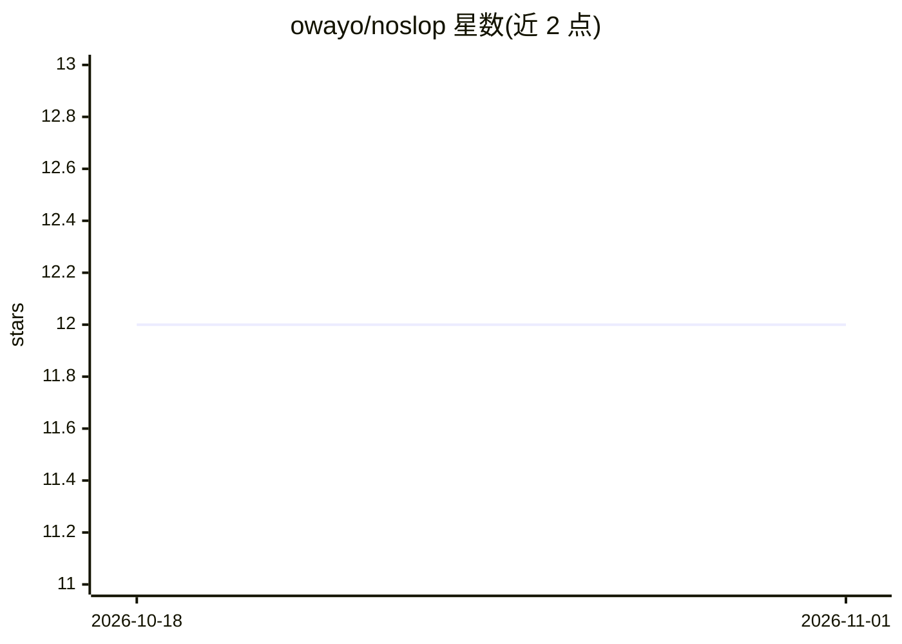

# owayo/noslop

⭐ 12 · Rust · MIT · 推送 2026-10-30 · [GitHub](https://github.com/owayo/noslop) · 个人维护 · 中文 README

**检测日语文章中 AI 写作惯用痕迹的 Rust Linter**

面向日语写作者与开发者的 Rust 命令行 Linter：用固定规则与文字统计检测 LLM 生成文本中常见的定型句、反复对比、单调节奏等『AI 臭さ』痕迹，另设可读性检查通道；通过内置 IPAdic 形态素词典判定品词规则，单个二进制运行、并行处理文件。可解析 Markdown 与 tree-sitter 提取的 19 种语言代码注释/静态文案。提供 MCP 服务器与 Claude Code 钩子，让 AI agent 写完后自行复查；也可用 `noslop calibrate` 在自有语料上校准规则。README 明确声明它不判定文章是否由 AI 写作。

## 筛选速览

| 维度 | 判定 | 备注 |
|---|---|---|
| AI 角色 | `ai-ecosystem` | LLM/agent 周边工具 |
| 许可风险 | `permissive` | MIT |
| 部署形态 | `library` | 以包/库形式分发 |
| 模型依赖 | — | README 未给出锁定关系 |
| 硬件要求 | — | 无带数字的原话,不猜 |
| 安装摩擦 | `medium` | 含编译或系统依赖之一 |
| 成熟度 | — | 结构信号不足 |

## 能力要点

- 基于规则与统计检测 AI 写作痕迹，为每条指摘标注手挂かり强度（强/中/弱）
- 内置 IPAdic 词典的单文件二进制，无需安装配置即可并行处理大仓库
- 提供 MCP 服务器、Claude Code 钩子与技能安装，供 AI agent 自查改稿
- 支持 19 种编程语言代码注释与静态文案检查，输出 text/JSON/TOON/GitHub 注解

## 适用场景

- 检查并修订 LLM 生成的日语文档与代码注释
- 在 CI（GitHub Actions）中检查提交文案的 AI 痕迹
- 通过 Claude Code 钩子让 AI 写完即自查改稿
- 对比改稿前后指摘变化、数字与固有名词是否消失

## 场景标签

 · 领域:文本质量/NLP 工具

## 证据(README 行号)

> L17: noslop は、日本語の文書やコード内のコメント・静的な文字列・JSX/HTML の文言を対象に、LLM が書いた文章に出やすい癖を決まった規則で指摘する Linter です。`と言えるでしょう` のような定型句、`〜ではなく`
> L33: - **AI エージェントに渡せる**: 直す箇所をルールごとにまとめた改稿指示を、Markdown・JSON・TOON（同じ内容を少ないトークンで表す形式）で出せる。MCP サーバー（`noslop mcp`）、Claude C

## 星数曲线

2026-10-18 12 → 2026-11-01 12（+0）

---
*卡片 v1 · prompt 1.4 · 生成 2026-11-01 · 置信度 high · 依据 README sha `14a0423ec2da` · [字段定义](../../DATASET.md)*
