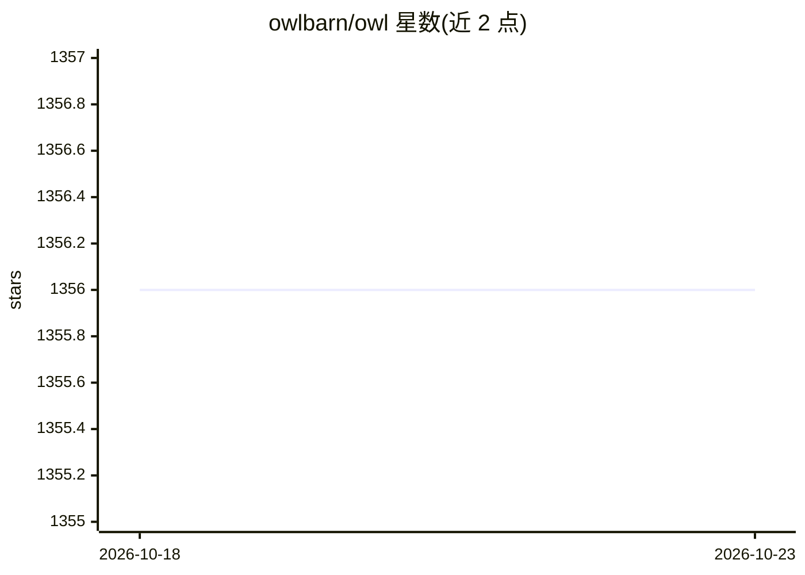

# owlbarn/owl

⭐ 1,356 · OCaml · MIT · 推送 2026-10-17 · [GitHub](https://github.com/owlbarn/owl) · 组织维护

**OCaml 科学计算库：矩阵、自动微分与神经网络的数值框架**

用 OCaml 编写的科学计算与工程计算系统，MIT 许可，由 Liang Wang 发起、Jianxin Zhao 领导。提供数学函数、统计与分布、n 维数组（含高级切片与广播）、线性代数、常微分方程、DFT、算法微分、优化、回归、可选计算图优化的深度神经网络、dataframe 处理与可视化（借助外部包 owl-plot）。核心设计为三种 Ndarray：基于 C 库的完整版、纯 OCaml 的 base 版、支持符号式计算图的 CGraph-Ndarray，三者均可支撑微分、优化与神经网络模块。安装遵循官方教程，或使用 docker 镜像。

## 筛选速览

| 维度 | 判定 | 备注 |
|---|---|---|
| AI 角色 | `ai-ecosystem` | LLM/agent 周边工具 |
| 许可风险 | `permissive` | MIT |
| 部署形态 | `None` |  |
| 模型依赖 | — | README 未给出锁定关系 |
| 硬件要求 | — | 无带数字的原话,不猜 |
| 安装摩擦 | `low` | 无编译、无系统依赖或容器化 |
| 成熟度 | — | 结构信号不足 |

## 能力要点

- 三种 Ndarray 架构：C 库版 / 纯 OCaml base 版 / CGraph 符号计算图版
- n 维数组支持高级切片与广播
- 算法微分（自动微分）、优化与神经网络模块
- 覆盖统计、线性代数、ODE、DFT、回归等科学计算功能

## 适用场景

- 在 OCaml 中编写数值计算与数据分析代码
- 构建自动微分、优化或神经网络应用
- 科研与工程场景下的矩阵与张量运算

## 场景标签

 · 领域:科学计算/数值库

## 证据(README 行号)

> L5: Owl is a dedicated system for scientific and engineering computing. The system is developed in OCaml and licensed un
> L21: - deep neural network and natural language processing with the optional support of computation graph optimization
> L31: Our mission is to push the frontier of high-performance scientific computing, provide both researchers and industry

## 星数曲线

2026-10-18 1,356 → 2026-10-23 1,356（+0）

---
*卡片 v1 · prompt 1.4 · 生成 2026-10-21 · 置信度 high · 依据 README sha `69dc4fee329d` · [字段定义](../../DATASET.md)*
