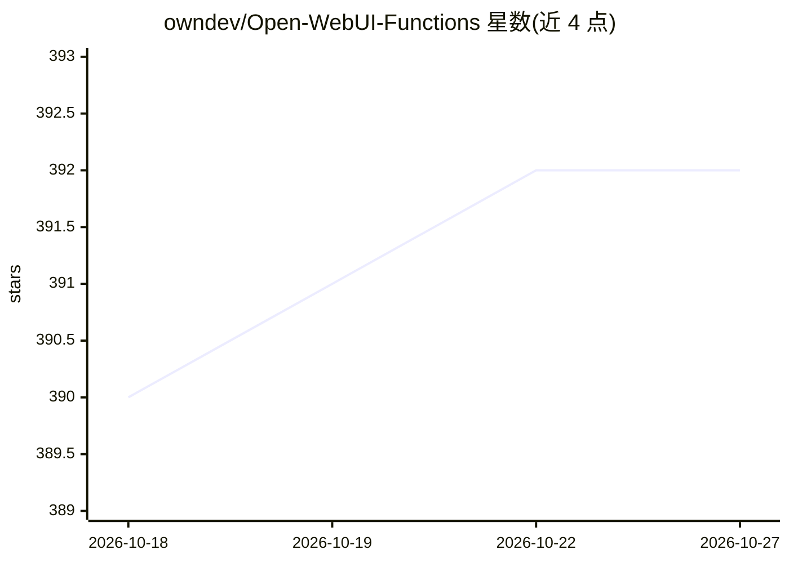

# owndev/Open-WebUI-Functions

⭐ 392 · Python · Apache-2.0 · 推送 2026-10-11 · [GitHub](https://github.com/owndev/Open-WebUI-Functions) · [官网](https://openwebui.com/u/owndev) · 个人维护

**扩展 Open WebUI 的 Python 函数集：接入 Azure AI、N8N、Gemini 等外部服务**

为 Open WebUI 编写的可复用 Python 函数集合，包含 pipelines、filters 与 integrations 四类管道：Azure AI Foundry 管道（接入 Azure OpenAI 及其他 Azure AI 模型，内置 Azure AI Search/RAG、引用卡片、相关性评分、预定义模型目录）、N8N 工作流管道（webhook 通信、AI agent 工具调用展示、NDJSON/SSE 流解析）、Infomaniak 管道与 Google Gemini 管道（思考等级配置、图像处理、错误重试）。安装方式为管理员在 Open WebUI 的 Functions 面板粘贴函数代码，需已运行 Open WebUI 实例；API 密钥通过 WEBUI_SECRET_KEY 加密存储。

## 筛选速览

| 维度 | 判定 | 备注 |
|---|---|---|
| AI 角色 | `ai-ecosystem` | LLM/agent 周边工具 |
| 许可风险 | `permissive` | Apache-2.0 |
| 部署形态 | `None` |  |
| 模型依赖 | locked-api |  |
| 硬件要求 | — | 无带数字的原话,不猜 |
| 安装摩擦 | `low` | 无编译、无系统依赖或容器化 |
| 成熟度 | — | 结构信号不足 |

## 能力要点

- Azure AI 管道支持 Azure AI Search/RAG、引用卡片与相关性评分
- N8N 管道解析 NDJSON/SSE 流并展示 AI agent 工具调用
- Gemini 管道提供思考等级配置、图像压缩与 API 错误重试
- API 密钥基于 WEBUI_SECRET_KEY 自动加密

## 适用场景

- 让 Open WebUI 接入 Azure OpenAI 并带 RAG 检索与引用
- 将 Open WebUI 对话转发到 N8N 工作流做自动化
- 在 Open WebUI 中使用 Google Gemini 模型并展示思考过程

## 场景标签

`模型网关` `RAG` · 领域:Agent 开发

## 证据(README 行号)

> L15: **Open-WebUI-Functions** is a collection of Python-based functions that extend Open WebUI with additional **pipelin
> L39: - 🧩 **Custom pipelines**: Extend Open WebUI with AI processing pipelines, including model inference and data transf
> L120: > Pipelines are processing functions that extend Open WebUI with **custom AI models**, **external integrations**, 

## 星数曲线

2026-10-18 390 → 2026-10-27 392（+2）

---
*卡片 v1 · prompt 1.4 · 生成 2026-10-22 · 置信度 high · 依据 README sha `bb40cf531728` · [字段定义](../../DATASET.md)*
