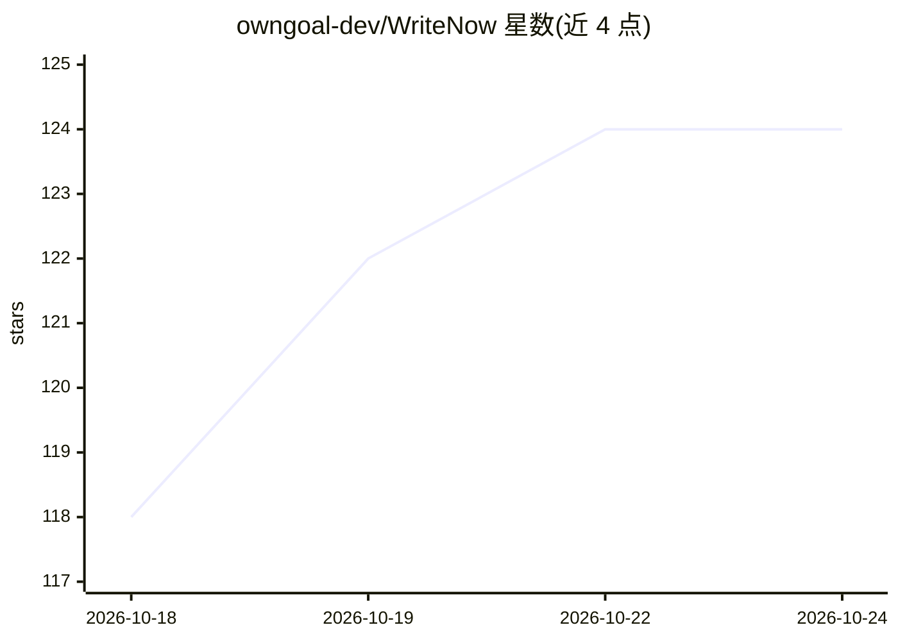

# owngoal-dev/WriteNow

⭐ 124 · Swift · MIT · 推送 2026-10-15 · [GitHub](https://github.com/owngoal-dev/WriteNow) · [官网](https://havoc.app/package/writenow) · 个人维护 · 中文 README

**iOS 越狱文本编辑菜单的 AI 写作助手**

iOS 平台的 AI 写作助手：以越狱 tweak 形式集成到系统文本编辑菜单，对选中文本提供校对、重写、友好/专业语气调整与精简功能；后端连接任意 OpenAI 兼容服务商（OpenAI、Together、OpenRouter、Groq、NVIDIA NIM 等）或 Ollama、Xinference 自托管服务器。另有 Lite 独立应用版，可通过 TrollFools 注入其他应用。要求 iOS 15+，tweak 版需越越环境，通过 Sileo 安装 .deb 包，需自备 API key。

## 筛选速览

| 维度 | 判定 | 备注 |
|---|---|---|
| AI 角色 | `ai-enhanced` | 去掉 AI 部分产品仍成立 |
| 许可风险 | `permissive` | MIT |
| 部署形态 | `None` |  |
| 模型依赖 | local-ok | 支持本地模型 |
| 硬件要求 | — | 无带数字的原话,不猜 |
| 安装摩擦 | `low` | 无编译、无系统依赖或容器化 |
| 成熟度 | — | 结构信号不足 |

## 能力要点

- 系统文本编辑菜单内调用校对/重写/语气调整
- 支持自选 OpenAI 兼容服务商并可配置多端点切换
- Lite 独立版可经 TrollFools 注入其他应用
- 支持 rootless 与 RootHide 两种越狱包配置

## 适用场景

- 在 iPhone 任意应用的文本框中一键校对或重写文字
- 把日常消息调整为友好或专业的语气
- 用自己的 API key 或自托管服务器处理文本

## 场景标签

`AI 写作` · 领域:内容生成

## 证据(README 行号)

> L5: An AI writing assistant for iOS. Proofread, rewrite, and refine your tone from the text editing menu, using an OpenA
> L21: - **Proofread** — Correct spelling, grammar, and punctuation while preserving your meaning.

## 星数曲线

2026-10-18 118 → 2026-10-24 124（+6）

---
*卡片 v1 · prompt 1.4 · 生成 2026-10-23 · 置信度 high · 依据 README sha `d03bc703b762` · [字段定义](../../DATASET.md)*
