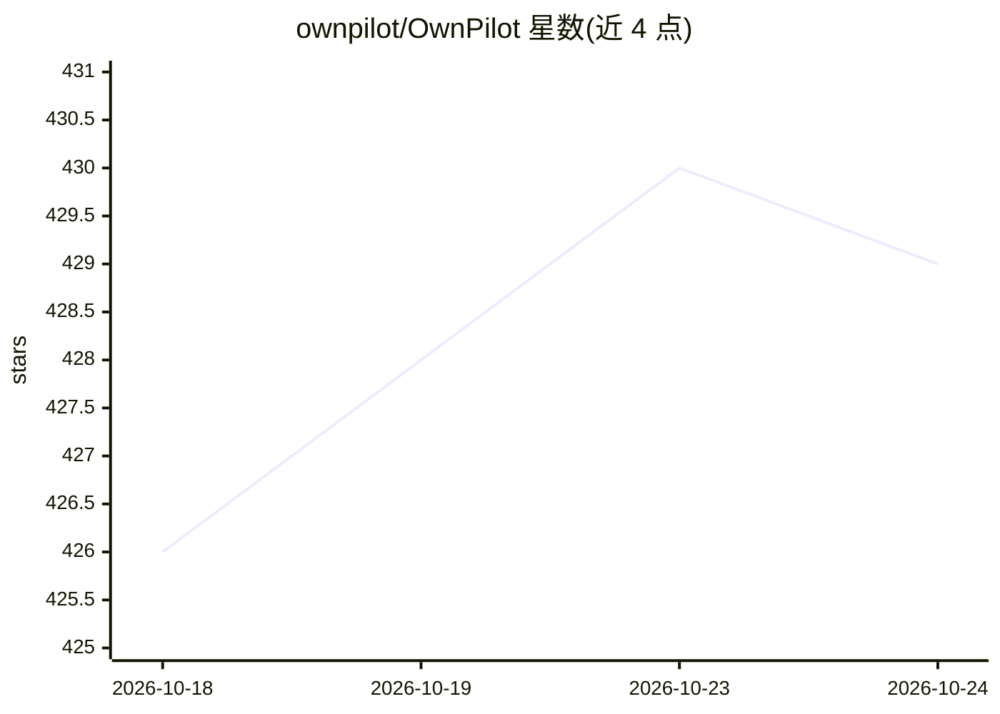

# ownpilot/OwnPilot

⭐ 430 · TypeScript · MIT · 推送 2026-09-08 · [GitHub](https://github.com/ownpilot/OwnPilot) · [官网](http://ownpilot.dev/) · 组织维护

**自托管的隐私优先个人 AI 助手平台，含自主 agent 与工具编排**

基于 Node.js/TypeScript 的自托管个人 AI 助手平台：支持 4 个原生与 8 个聚合 LLM 提供商及任意 OpenAI 兼容端点，可自动发现局域网内 Ollama、LM Studio、LocalAI、vLLM。内置 250+ 工具、Claw 自主 agent 运行时（隔离工作区、子 agent、审计日志）、多 agent crew、MCP 客户端/服务器、浏览器自动化（Playwright）、语音管线、IoT 边缘设备控制（MQTT）与 Telegram/WhatsApp 接入，并提供笔记、任务、记忆等个人数据管理。通过 Docker 或源码安装，数据本地留存。

## 筛选速览

| 维度 | 判定 | 备注 |
|---|---|---|
| AI 角色 | `ai-native` | 本体是模型或模型工具 |
| 许可风险 | `permissive` | MIT |
| 部署形态 | `self-host` | docker 或自建部署 |
| 模型依赖 | local-ok | 支持本地模型 |
| 硬件要求 | — | 无带数字的原话,不猜 |
| 安装摩擦 | `low` | 无编译、无系统依赖或容器化 |
| 成熟度 | — | 结构信号不足 |

## 能力要点

- Claw 自主 agent 运行时：隔离工作区、4 种执行模式、子 agent 与逐调用审计日志
- 250+ 内置工具 + 4 元工具代理与 MCP 客户端/服务器
- 多提供商路由（最便宜/最快/最智能等策略）与本地模型自动发现
- Telegram/WhatsApp 接入、语音管线与 IoT 边缘设备控制

## 适用场景

- 自托管一个数据不出本地的个人 AI 助手
- 通过自然语言创建并运行周期性自主 agent（监控、简报、数据分析）
- 统一接入多家 LLM 提供商与本地模型，按策略路由
- 经 Telegram/WhatsApp 或语音与助手交互

## 场景标签

`AI 助手` · 领域:对话与助手

## 证据(README 行号)

> L3: > Privacy-first personal AI assistant platform with Claw autonomous agents, soul agents, crews, AI agent creator, to
> L23: - **Multi-Provider Support** — 4 native providers (OpenAI, Anthropic, Google, Zhipu) + 8 aggregator providers (Toge
> L77: - **AI Agent Creator** — Conversational agent creation: describe what you need in plain language, refine through ch

## 星数曲线

2026-10-18 426 → 2026-10-24 429（+3）

---
*卡片 v1 · prompt 1.4 · 生成 2026-10-21 · 置信度 mid · 依据 README sha `9f428b87f0da` · [字段定义](../../DATASET.md)*
