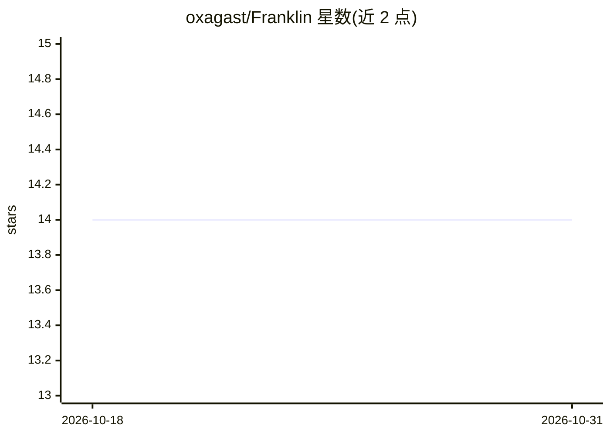

# oxagast/Franklin

⭐ 14 · Perl · NOASSERTION · 推送 2025-11-30 · [GitHub](https://github.com/oxagast/Franklin) · [官网](https://franklin.oxasploits.com) · 个人维护

**接入 Cohere API 的 IRC 聊天机器人（irssi Perl 脚本）**

以 Perl 脚本形式运行于 irssi 内的 IRC 聊天机器人，后端调用 Cohere Coral command API 生成回答，此前使用 OpenAI GPT 3.5 Turbo Instruct API。功能包括：读取频道内 URL 并解读、按频道保持约 7 行对话上下文、无人提问时的自主发言（chatterbox 模式可调）、长回答按 TXID 编号分段续写并存为网页、心跳监测与邮件/短信通知、滥用用户屏蔽名单、token 用量与成本统计面板。通过 irssi 的 /set 命令配置，需配置 API key 与可写的 webserver 目录。

## 筛选速览

| 维度 | 判定 | 备注 |
|---|---|---|
| AI 角色 | `ai-native` | 本体是模型或模型工具 |
| 许可风险 | `none` | NOASSERTION |
| 部署形态 | `None` |  |
| 模型依赖 | locked-api |  |
| 硬件要求 | — | 无带数字的原话,不猜 |
| 安装摩擦 | `low` | 无编译、无系统依赖或容器化 |
| 成熟度 | — | 结构信号不足 |

## 能力要点

- 调用 Cohere Coral command API 生成 IRC 频道内的对话回答
- 频道级对话上下文（默认回读约 7 行）注入提示前导
- 长回答按 TXID 编号分块存储为网页并支持续写
- 心跳监测、屏蔽名单与 token 成本统计面板

## 适用场景

- 在 IRC 频道部署一个可对话的 AI 机器人
- 让频道用户通过提及机器人姓名提问或让其续写被截断的回答
- 运营者查看 token 用量与成本估计

## 场景标签

`聊天机器人` · 领域:对话与助手

## 证据(README 行号)

> L4: ## Franklin is a ChatGPT backed IRC bot
> L29: * Now upgraded to use the ~~OpenAI GPT 3.5 Turbo Instruct API~~ Cohere Coral command API.

## 星数曲线

2026-10-18 14 → 2026-10-31 14（+0）

---
*卡片 v1 · prompt 1.4 · 生成 2026-10-31 · 置信度 high · 依据 README sha `a9fdc66c9a7a` · [字段定义](../../DATASET.md)*
