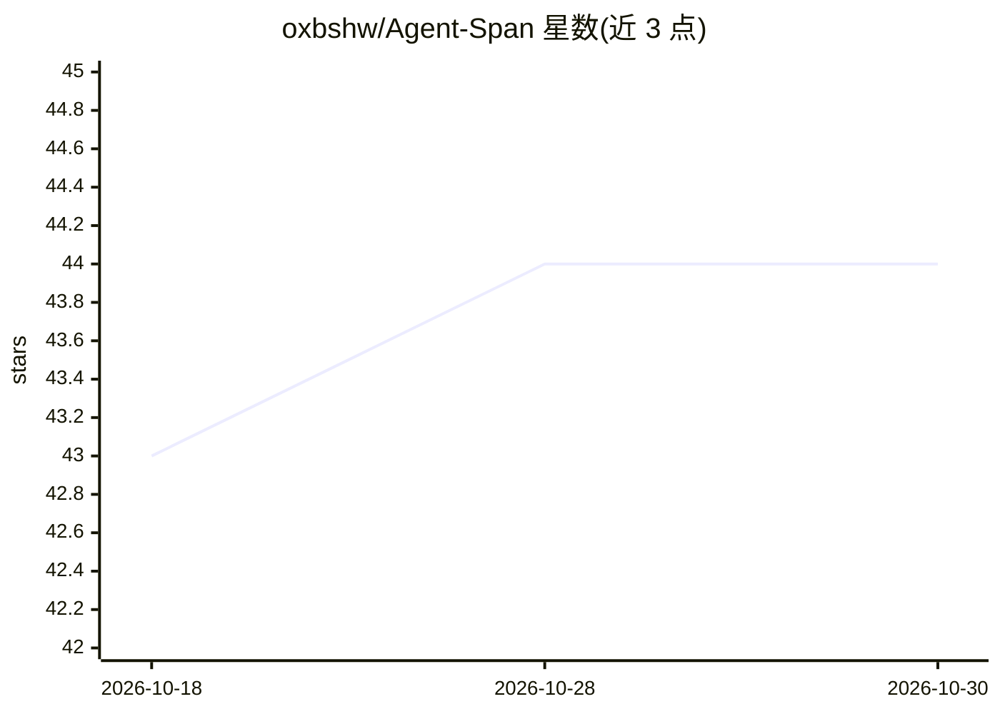

# oxbshw/Agent-Span

⭐ 44 · Rust · MIT · 推送 2026-09-01 · [GitHub](https://github.com/oxbshw/Agent-Span) · [官网](https://github.com/oxbshw/Agent-Span) · 个人维护 · 中文 README

**面向 AI Agent 的 Web 访问网关：52 平台统一读取/搜索**

用异步 Rust 实现的自托管网关，为 AI agent 提供 52 个互联网平台的持久化、带缓存的读取与搜索访问，通过 REST API、SSE 事件流、MCP 服务器（91 个工具）、9 种语言 SDK、CLI 与 React 面板交付。后端具备自愈监控（故障自动切换、重装 CLI 工具）、L1/L2/L3 缓存、自适应路由、联邦搜索、请求合并与 agent 内存暂存区。支持多租户、RBAC、审计与 Prometheus 指标。不适用于需要登录/填表的浏览器自动化场景，SDK 尚未发布到包管理器。

## 筛选速览

| 维度 | 判定 | 备注 |
|---|---|---|
| AI 角色 | `ai-ecosystem` | LLM/agent 周边工具 |
| 许可风险 | `permissive` | MIT |
| 部署形态 | `self-host` | docker 或自建部署 |
| 模型依赖 | — | README 未给出锁定关系 |
| 硬件要求 | — | 无带数字的原话,不猜 |
| 安装摩擦 | `low` | 无编译、无系统依赖或容器化 |
| 成熟度 | `idea` | |

## 能力要点

- 52 个平台通道经统一 REST/SSE/MCP（91 工具）接口访问
- 后端自愈：自动切换故障后端并重装损坏的 CLI 工具
- 9 种语言 SDK（Py/JS/Rust/Go/Ruby/Java/PHP/C#/Swift）
- 无模型调用的确定性内容原语：token 预算编译、SimHash 指纹、结构化抽取

## 适用场景

- 让 AI agent 以统一 API 读取/搜索多个互联网平台
- 通过 MCP 接入 Claude Code、Cursor、Windsurf 等客户端
- 自托管部署并监控多通道 Web 数据访问的延迟与健康状态

## 场景标签

`网页抓取` `模型网关` · 领域:Agent 开发

## 证据(README 行号)

> L12: AgentSpan gives AI agents persistent, scalable, **cached** access to **52 internet
> L13: platforms** through one REST API, an SSE event stream, a native **MCP server (91

## 星数曲线

2026-10-18 43 → 2026-10-30 44（+1）

---
*卡片 v1 · prompt 1.4 · 生成 2026-10-25 · 置信度 mid · 依据 README sha `eb7ef8073d01` · [字段定义](../../DATASET.md)*
