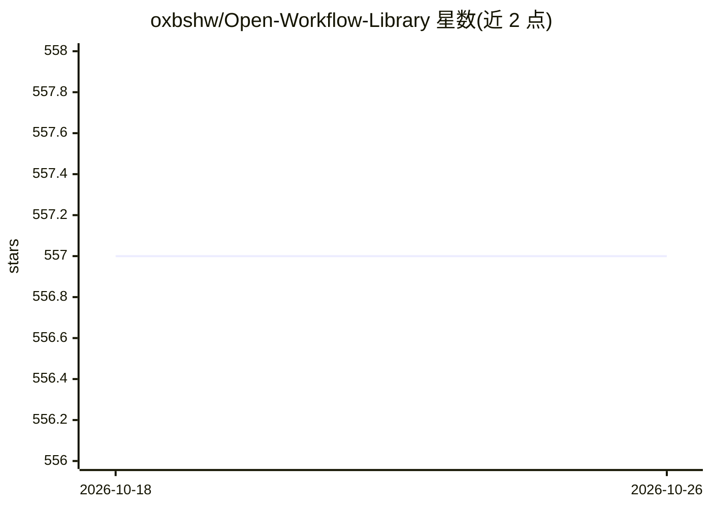

# oxbshw/Open-Workflow-Library

⭐ 557 · Python · MIT · 推送 2026-05-24 · [GitHub](https://github.com/oxbshw/Open-Workflow-Library) · 个人维护

**n8n 工作流知识库与审计工具集：收集、索引、校验自动化工作流**

以约 1,700 个 n8n 工作流文件与 420 个生成模板为起点的工作流情报项目：提供只读审计工具（编目、密钥扫描并脱敏）、统一目录与 CLI 检索、JSON Schema 校验、重复分析与人工审核式修复建议；另含面向人与 LLM 的 wiki 知识库与框架无关的 Universal Workflow IR。Prompt→IR 仅为确定性关键词规则 MVP，不调用 LLM；仅静态校验，无运行时执行；多框架导出（Dify/LangGraph/Make/Zapier）仅文档化未实现。全工具为 Python 3.12+ 标准库，无需本机安装 n8n。

## 筛选速览

| 维度 | 判定 | 备注 |
|---|---|---|
| AI 角色 | `ai-knowledge` | 知识聚合/清单类 |
| 许可风险 | `permissive` | MIT |
| 部署形态 | `None` |  |
| 模型依赖 | — | README 未给出锁定关系 |
| 硬件要求 | — | 无带数字的原话,不猜 |
| 安装摩擦 | `low` | 无编译、无系统依赖或容器化 |
| 成熟度 | `idea` | |

## 能力要点

- 约 1,700 个 n8n 工作流文件编目入索引，含密钥扫描与脱敏
- Universal Workflow IR 与元数据/修复建议/学习事件四套 JSON Schema
- 只读审计与 CLI 检索、重复分析、修复建议均不自动修改文件
- prompt→IR→n8n JSON 的确定性证明链（静态校验、无外部调用）

## 适用场景

- 我需要检索现成 n8n 工作流作为搭建起点
- 我想对自有 n8n 工作流集合做编目、密钥扫描与重复分析
- 我想了解跨框架（Dify/LangGraph/Make/Zapier）工作流迁移的路线图

## 场景标签

`精选清单` · 领域:学习与行业

## 证据(README 行号)

> L3: > Open Workflow Library is an open workflow intelligence project for collecting, indexing, validating, repairing, an
> L44: - A collection of ~1,700 n8n workflow files under `workflows/` and additional automation samples under `automation/
> L52: - An **LLM wiki** under `wiki/` with seed content for patterns, integrations, repair rules, failure cases, and fram

## 星数曲线

2026-10-18 557 → 2026-10-26 557（+0）

---
*卡片 v1 · prompt 1.4 · 生成 2026-10-22 · 置信度 high · 依据 README sha `e394bb39bc1d` · [字段定义](../../DATASET.md)*
