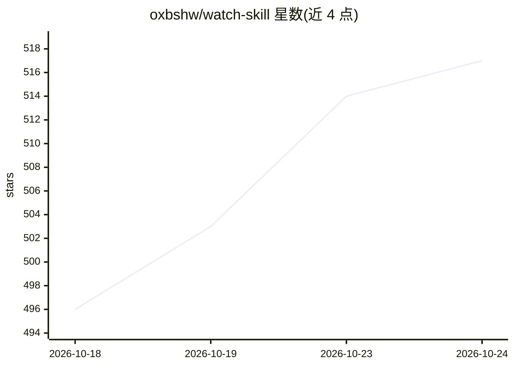

# oxbshw/watch-skill

⭐ 520 · Python · MIT · 推送 2026-10-14 · [GitHub](https://github.com/oxbshw/watch-skill) · [官网](https://pypi.org/project/watch-skill/) · 个人维护

**给 AI agent 提供视听感知与确定性验证的工具引擎**

Watch Skill 将视频、音频与屏幕活动转为带绝对时间戳的帧、转写文本与 OCR 文本，索引后可长期查询，答案引用可打开的时间点；另以独立进程评估冻结的验证契约（文件摘要、JSON、SQL、HTTP、DOM），输出 VERIFIED/FAILED/UNVERIFIED/INCONCLUSIVE 四种判定而非模型意见。可通过 MCP（39 个工具）、CLI 或 REST 接入任意 agent。DeepWatch 是基于官方 DeepSeek Harness 的工作区发行版，浏览器内运行，含工具调用回执、工作区边界检查与运行对比。分发为 PyPI 的 watch-skill 与 npm 的 @deepwatch/cli、@deepwatch/dsh-bundle 三个人工安装入口，共 21 个包。

## 筛选速览

| 维度 | 判定 | 备注 |
|---|---|---|
| AI 角色 | `ai-ecosystem` | LLM/agent 周边工具 |
| 许可风险 | `permissive` | MIT |
| 部署形态 | `library` | 以包/库形式分发 |
| 模型依赖 | locked-api |  |
| 硬件要求 | — | 无带数字的原话,不猜 |
| 安装摩擦 | `medium` | 含编译或系统依赖之一 |
| 成熟度 | — | 结构信号不足 |

## 能力要点

- 视频/音频/屏幕活动转为带时间戳的帧、转写与 OCR 并可查询
- 独立进程评估验证契约，四态判定不经由语言模型
- MCP（stdio，39 工具）/CLI/REST 三种接入方式
- DeepWatch 工作区基于官方 DeepSeek Harness，工具调用留回执且受工作区边界约束

## 适用场景

- 给已有的 MCP 客户端 agent（Claude Code、Cursor 等）补充视听感知与验证能力
- 校验 agent 执行结果是否真实达成（did that actually work）
- 在自建的 DeepSeek Harness profile 中加入 watch 能力

## 场景标签

`语音识别` `OCR` `多模态` · 领域:感知与多模态

## 证据(README 行号)

> L7: **Watch Skill** turns video, audio and screen activity into searchable,
> L10: already use over MCP.
> L69: Any agent can use it: **MCP**, a **CLI**, or a **REST** API.

## 星数曲线

2026-10-18 496 → 2026-10-24 517（+21）

---
*卡片 v1 · prompt 1.4 · 生成 2026-10-22 · 置信度 high · 依据 README sha `867415f84ec0` · [字段定义](../../DATASET.md)*
