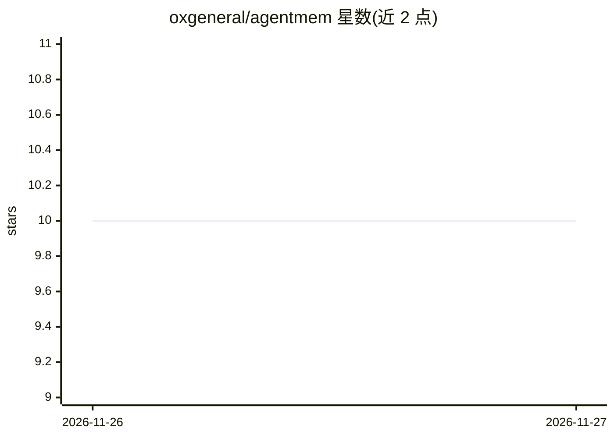

# oxgeneral/agentmem

⭐ 10 · Python · MIT · 推送 2026-02-28 · [GitHub](https://github.com/oxgeneral/agentmem) · 个人维护

**给 AI agent 提供单文件 SQLite 持久记忆的 Python 库与 MCP 服务器**

为跨会话运行的 AI agent 提供持久化记忆：以单个 SQLite 文件为存储，FTS5 关键词检索与向量语义检索融合排序，划分 core/learned/episodic/working/procedural 五层记忆，支持命名空间隔离、事实版本链、正则实体抽取、近似记忆合并与时间衰减排序。可通过 Python API、CLI、16 个 MCP 工具或 14 个 HTTP 端点使用；提供 0 依赖到 12MB 的四种运行模式，不需要 PyTorch 或云服务。MIT 许可。

## 筛选速览

| 维度 | 判定 | 备注 |
|---|---|---|
| AI 角色 | `ai-ecosystem` | LLM/agent 周边工具 |
| 许可风险 | `permissive` | MIT |
| 部署形态 | `library` | 以包/库形式分发 |
| 模型依赖 | — | README 未给出锁定关系 |
| 硬件要求 | — | 无带数字的原话,不猜 |
| 安装摩擦 | `low` | 无编译、无系统依赖或容器化 |
| 成熟度 | — | 结构信号不足 |

## 能力要点

- FTS5 关键词 + 向量语义的混合检索，自适应融合排序
- 16 个 MCP 工具与 14 个 HTTP REST 端点两种服务方式
- 五种记忆分层与 24 小时/90 天自动压缩策略
- 四种运行模式：纯标准库 0KB 到 sqlite-vec+model2vec 12MB

## 适用场景

- 让 agent 跨会话记住用户偏好与已确认的事实
- 多用户/多 agent 场景下按命名空间隔离记忆
- 上下文压缩前用 save_state 抢救会话状态
- 从聊天记录自动抽取事实、决策与 TODO

## 场景标签

`Agent 记忆` · 领域:Agent 开发

## 证据(README 行号)

> L15: Every AI agent session starts from zero. Context windows compress, conversations end, memory vanishes. `agentmem` g
> L19: - **16 MCP tools**: recall, remember, save_state, compact, consolidate, entities, and more
> L20: - **HTTP REST API**: 14 endpoints, zero-dependency server, CORS-ready

## 星数曲线

2026-11-26 10 → 2026-11-27 10（+0）

---
*卡片 v1 · prompt 1.4 · 生成 2026-11-26 · 置信度 high · 依据 README sha `7b30d2f56758` · [字段定义](../../DATASET.md)*
