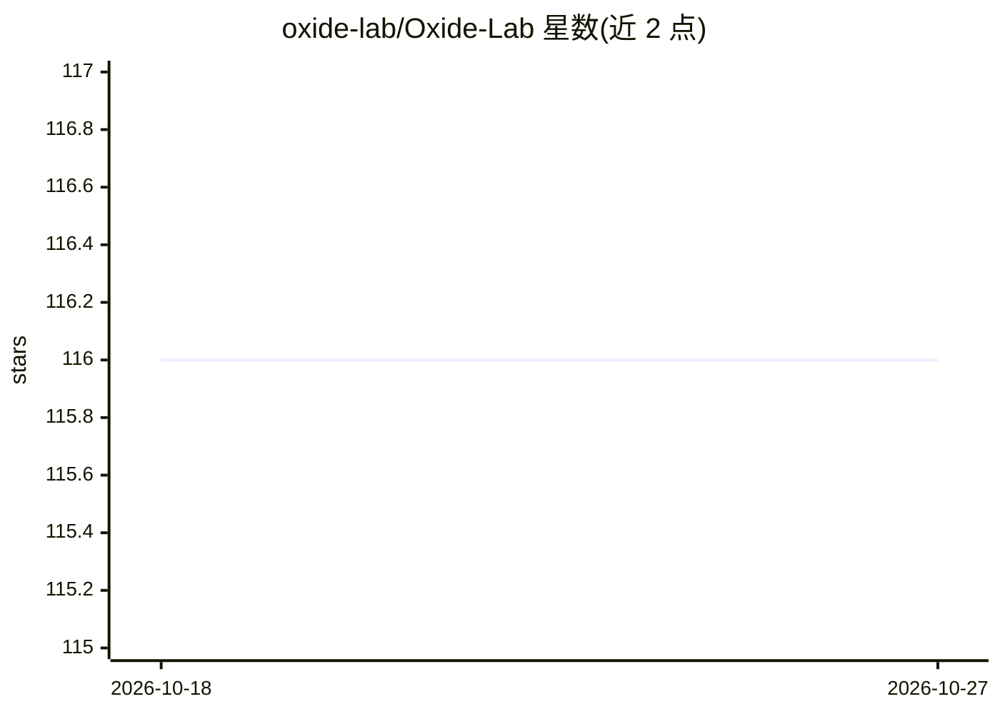

# oxide-lab/Oxide-Lab

⭐ 116 · Rust · Apache-2.0 · 推送 2026-08-12 · [GitHub](https://github.com/oxide-lab/Oxide-Lab) · [官网](https://oxidelab.tech) · 个人维护

**本地运行 LLM 的私有桌面聊天应用，数据不出本机**

用 Rust 与 Tauri v2 构建、前端为 Svelte 5 的原生桌面应用，基于 Hugging Face 的 Candle 框架在本机执行大模型推理，提供聊天界面与流式生成，不依赖云服务与外部 API。支持 Llama、Qwen 系列、Mistral、Mixtral、DeepSeek、Yi、SmolLM2 等架构，可加载 GGUF 与 SafeTensors 格式模型，硬件加速覆盖 CPU、CUDA、Metal、Intel MKL 与 Apple Accelerate。安装需 Node.js 与 Rust 工具链，通过 npm 脚本按后端（CPU/CUDA）构建。

## 筛选速览

| 维度 | 判定 | 备注 |
|---|---|---|
| AI 角色 | `ai-native` | 本体是模型或模型工具 |
| 许可风险 | `permissive` | Apache-2.0 |
| 部署形态 | `library` | 以包/库形式分发 |
| 模型依赖 | — | README 未给出锁定关系 |
| 硬件要求 | — | 无带数字的原话,不猜 |
| 安装摩擦 | `medium` | 含编译或系统依赖之一 |
| 成熟度 | — | 结构信号不足 |

## 能力要点

- 100% 本地推理，无需联网与外部 API
- 支持 GGUF 与 SafeTensors 模型格式
- 硬件加速：CPU、CUDA、Metal、Intel MKL、Apple Accelerate
- 多语言界面：英语、俄语、巴西葡萄牙语

## 适用场景

- 在本机离线与 LLM 对话，数据不外发
- 加载 Hugging Face 下载的 GGUF/SafeTensors 模型聊天
- 在无网络环境下使用个人 AI 助手

## 场景标签

`聊天机器人` `AI 助手` · 领域:对话与助手

## 证据(README 行号)

> L22: Oxide Lab is a native desktop application for running large language models locally. Built with Rust and Tauri v2, 
> L34: - 100% local inference — your data never leaves your machine

## 星数曲线

2026-10-18 116 → 2026-10-27 116（+0）

---
*卡片 v1 · prompt 1.4 · 生成 2026-10-23 · 置信度 high · 依据 README sha `b6ea3618bf77` · [字段定义](../../DATASET.md)*
