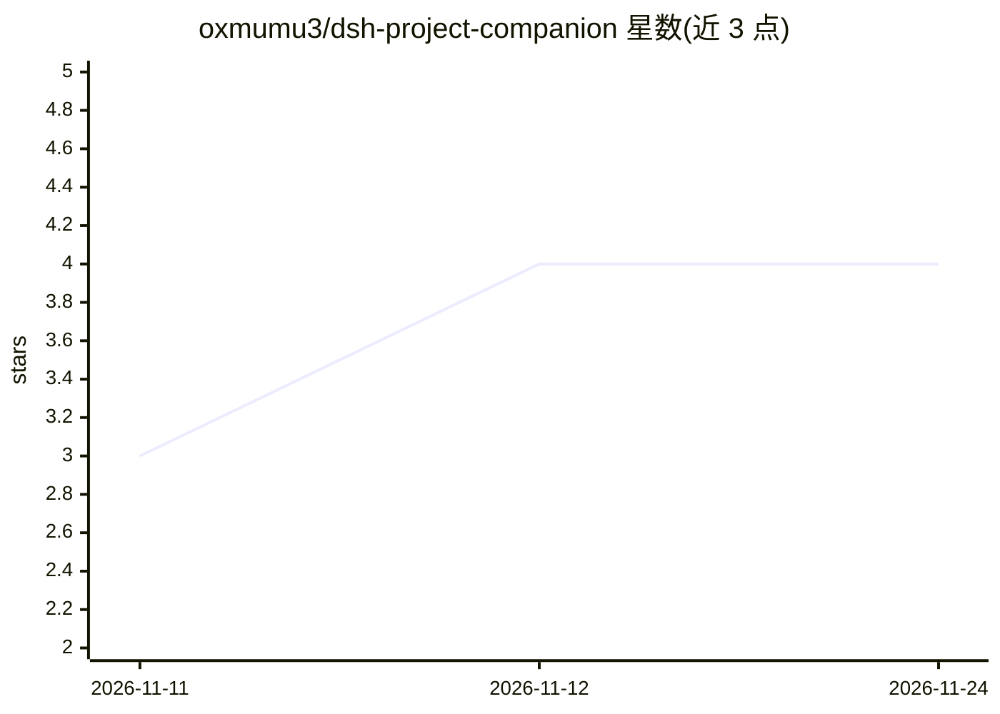

# oxmumu3/dsh-project-companion

⭐ 4 · JavaScript · MIT · 推送 2026-11-21 · [GitHub](https://github.com/oxmumu3/dsh-project-companion) · [官网](https://github.com/oxmumu3/dsh-project-companion/releases/tag/v0.12.0-preview.3) · 个人维护 · 中文 README

**给个人用户的长在微信里的项目助理，跨会话记忆与跟进交办**

运行于 DeepSeek Harness 的社区插件：把用户交代的事项接入指定项目，保存目标、约束、决策、阻塞与下一步等项目记忆，支持按时间周期跟进并把执行结果回传到原微信对话。工作区读取、账号连接、消息投递均需用户逐项授权，数据留在本机 Harness profile。要求官方 Harness 0.2.x 与 Node.js 22.13+，通过插件包名安装，仅支持 macOS。

## 筛选速览

| 维度 | 判定 | 备注 |
|---|---|---|
| AI 角色 | `ai-native` | 本体是模型或模型工具 |
| 许可风险 | `permissive` | MIT |
| 部署形态 | `None` |  |
| 模型依赖 | — | README 未给出锁定关系 |
| 硬件要求 | — | 无带数字的原话,不猜 |
| 安装摩擦 | `low` | 无编译、无系统依赖或容器化 |
| 成熟度 | `idea` | |

## 能力要点

- 跨会话项目记忆：保存目标、约束、决策与下一步并保留来源
- 微信内明确交办、状态查询与结果回传，通道/手机/验收三状态分开报告
- 分项授权机制：连接、启用、读取、跟进四件事分别确认
- health 自检只读本机，不发外部请求

## 适用场景

- 人不在电脑前时从微信交办任务并收回结果
- 让助理记住项目的约束与决策，避免每次重复说明
- 每天固定时间汇总 Gmail、日历与笔记的进展与风险

## 场景标签

`AI 助手` `工作流自动化` · 领域:效率与自动化

## 证据(README 行号)

> L5:  在微信或电脑交代一件事，Dot 把它接进对应项目、记住来龙去脉、按你定的时间跟进，再把执行结果带回原对话。
> L23: 所以 Dot 只做一件事：**把一件事接进项目，记住它，跟进它，把结果带回来。** 其余连接和资料，都是可选增强。
> L57: |在微信里办事|明确交办、状态查询、把这一轮执行回复带回原对话；问「任务状态」不新建执行，说「停一下」停止当前任务、回复短码继续原任务；电脑端原生对话与 Harness 内浮层。详见在微信继续当前任务|

## 星数曲线

2026-11-11 3 → 2026-11-24 4（+1）

---
*卡片 v1 · prompt 1.4 · 生成 2026-11-21 · 置信度 high · 依据 README sha `ae0ee14e5283` · [字段定义](../../DATASET.md)*
