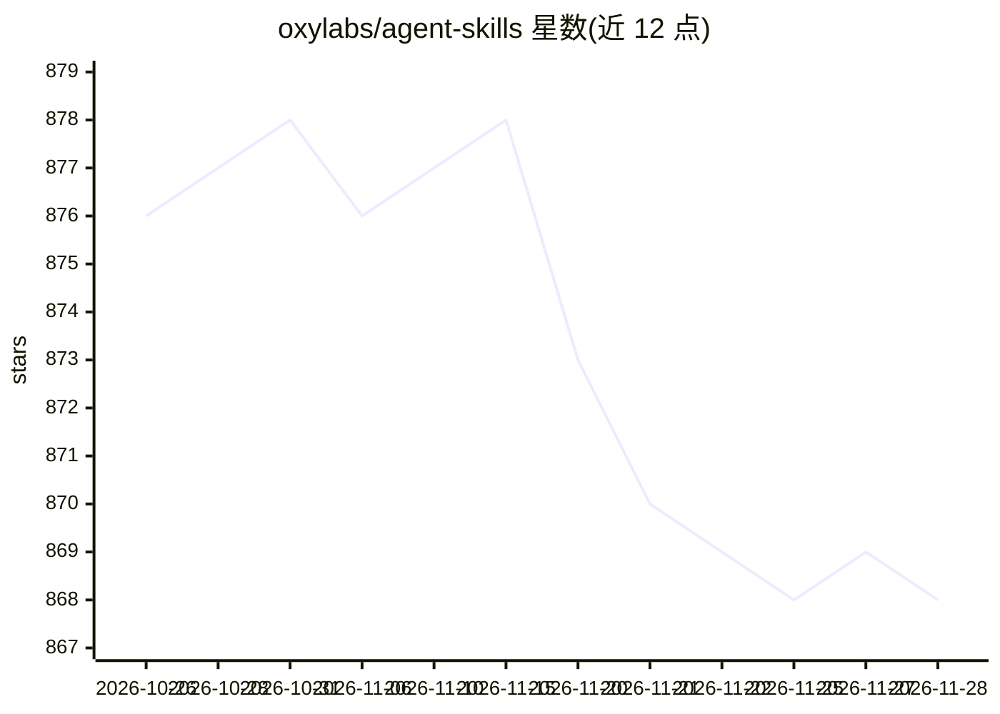

# oxylabs/agent-skills

⭐ 868 · JavaScript · MIT · 推送 2026-11-27 · [GitHub](https://github.com/oxylabs/agent-skills) · 组织维护

**给 AI agent 用的 Oxylabs 产品技能集：接入代理与网页数据服务**

Oxylabs 官方发布的 agent 技能集合，包含 5 个技能：Proxies、Web Unblocker、Web Scraper API、Agent Browser、Video Data，每个技能以结构化指令形式供 AI agent 调用对应服务。提供产品路由表帮助按需求选择技能，全部技能通过 .env 环境变量进行身份认证。支持经 Claude Code 插件市场一键安装全部技能，其他 agent 可用 npx skills add 通用方式安装。使用需具备 Oxylabs 账户凭据。

## 筛选速览

| 维度 | 判定 | 备注 |
|---|---|---|
| AI 角色 | `ai-ecosystem` | LLM/agent 周边工具 |
| 许可风险 | `permissive` | MIT |
| 部署形态 | `library` | 以包/库形式分发 |
| 模型依赖 | locked-api |  |
| 硬件要求 | — | 无带数字的原话,不猜 |
| 安装摩擦 | `low` | 无编译、无系统依赖或容器化 |
| 成熟度 | — | 结构信号不足 |

## 能力要点

- 5 个官方技能覆盖代理、网页解锁、结构化抓取、远程浏览器、视频数据
- 按需求场景给出产品路由表
- Claude Code 插件市场一键安装全部技能，通用 agent 走 npx 安装
- 统一通过 .env 环境变量认证各产品

## 适用场景

- 让 agent 通过 Web Unblocker 抓取有防护的页面
- 用 Web Scraper API 从电商与搜索结果获取结构化 JSON
- 通过 Agent Browser 执行点击、表单、截图等 Playwright/Puppeteer 自动化
- 用 Video Data 技能提取 YouTube 元数据、字幕与下载视频

## 场景标签

`网页抓取` `浏览器自动化` · 领域:效率与自动化

## 证据(README 行号)

> L10: Official agent skills for Oxylabs products. Each skill provides structured instructions that AI agents can use to i
> L12: ## Available Skills

## 星数曲线

2026-10-26 876 → 2026-11-28 868（-8）

---
*卡片 v1 · prompt 1.4 · 生成 2026-11-28 · 置信度 high · 依据 README sha `22a48b93ea73` · [字段定义](../../DATASET.md)*
