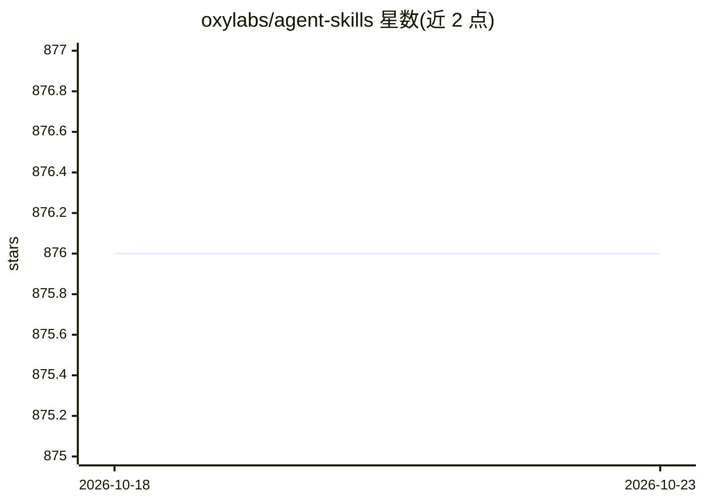

# oxylabs/agent-skills

⭐ 876 · JavaScript · MIT · 推送 2026-10-16 · [GitHub](https://github.com/oxylabs/agent-skills) · 组织维护

**Oxylabs 官方 AI agent 技能集：让 agent 接入代理与采集服务**

Oxylabs 官方维护的 agent 技能仓库，包含 5 个技能：Proxies（住宅/移动/数据中心代理与地理位置定向）、Web Unblocker、Web Scraper API（40+ 目标结构化 JSON 抓取）、Agent Browser（CDP 远程浏览器，配合 Playwright/Puppeteer）与 Video Data（视频元数据/字幕/下载）。每个技能以结构化指令形式供 AI agent 调用。可通过 Claude Code 插件市场安装，或用 npx skills add 通用方式安装给其他 agent；全部技能经 .env 环境变量完成认证。

## 筛选速览

| 维度 | 判定 | 备注 |
|---|---|---|
| AI 角色 | `ai-ecosystem` | LLM/agent 周边工具 |
| 许可风险 | `permissive` | MIT |
| 部署形态 | `library` | 以包/库形式分发 |
| 模型依赖 | — | README 未给出锁定关系 |
| 硬件要求 | — | 无带数字的原话,不猜 |
| 安装摩擦 | `low` | 无编译、无系统依赖或容器化 |
| 成熟度 | — | 结构信号不足 |

## 能力要点

- 5 个技能覆盖代理、反封锁抓取、结构化采集、远程浏览器与视频数据
- 支持 Claude Code 插件市场一键安装 5 个技能
- 提供 npx skills add 通用安装方式，适配其他 agent
- 统一 .env 环境变量认证，按产品区分凭据

## 适用场景

- 让 AI agent 通过代理网络访问受保护网页
- 用 agent 抓取电商等 40+ 目标的结构化 JSON 数据
- 让 agent 经 CDP 操控远程浏览器完成点击、表单等自动化

## 场景标签

`浏览器自动化` `网页抓取` · 领域:效率与自动化

## 证据(README 行号)

> L5: Official agent skills for Oxylabs products. Each skill provides structured instructions that AI agents can use to in
> L14: |Agent Browser|`skills/agent-browser`|Remote agent browsers via CDP (Playwright/Puppeteer) with built-in request ha

## 星数曲线

2026-10-18 876 → 2026-10-23 876（+0）

---
*卡片 v1 · prompt 1.4 · 生成 2026-10-21 · 置信度 high · 依据 README sha `01fa2ec7346c` · [字段定义](../../DATASET.md)*
