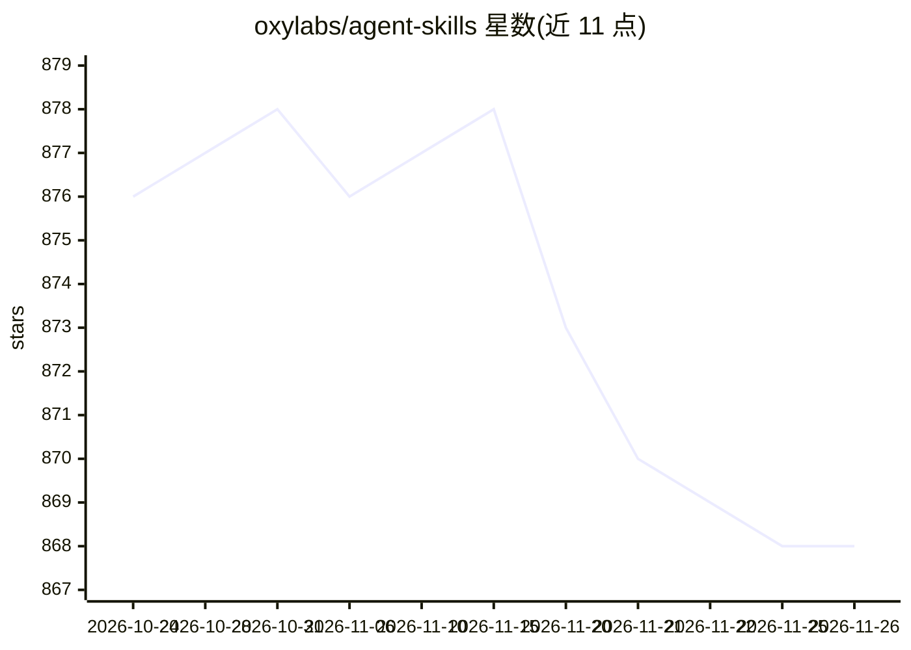

# oxylabs/agent-skills

⭐ 868 · JavaScript · MIT · 推送 2026-11-23 · [GitHub](https://github.com/oxylabs/agent-skills) · 组织维护

**让 AI agent 调用 Oxylabs 代理与抓取服务的官方技能包**

Oxylabs 官方发布的 agent skills 集合，包含 5 个技能：Proxies（住宅/移动/数据中心/ISP 代理，支持地理定位、IP 轮换、会话保持）、Web Unblocker、Web Scraper API（40+ 目标的结构化 JSON 解析）、Agent Browser（CDP 远程浏览器）与 Video Data（视频元数据/字幕/下载）。每个技能以结构化指令形式供 AI agent 与 Oxylabs 服务交互，通过 .env 环境变量认证，经 Claude Code 插件市场或 npx 安装。

## 筛选速览

| 维度 | 判定 | 备注 |
|---|---|---|
| AI 角色 | `ai-ecosystem` | LLM/agent 周边工具 |
| 许可风险 | `permissive` | MIT |
| 部署形态 | `library` | 以包/库形式分发 |
| 模型依赖 | — | README 未给出锁定关系 |
| 硬件要求 | — | 无带数字的原话,不猜 |
| 安装摩擦 | `low` | 无编译、无系统依赖或容器化 |
| 成熟度 | — | 结构信号不足 |

## 能力要点

- 5 个官方技能覆盖代理、解锁、抓取 API、远程浏览器与视频数据
- 提供按任务需求选择产品的路由表
- 统一通过 .env 环境变量认证
- 支持 Claude Code 插件市场安装及通用 agent 的 npx 安装

## 适用场景

- 让 AI agent 抓取受保护网页并解析为结构化 JSON
- 在 Playwright/Puppeteer 自动化中使用远程浏览器
- 用代理网络获取指定地区的原始流量
- 提取 YouTube 元数据、字幕与视频下载

## 场景标签

`网页抓取` `浏览器自动化` · 领域:效率与自动化

## 证据(README 行号)

> L10: Official agent skills for Oxylabs products. Each skill provides structured instructions that AI agents can use to i
> L36: ### Claude Code (plugin marketplace)

## 星数曲线

2026-10-24 876 → 2026-11-26 868（-8）

---
*卡片 v1 · prompt 1.4 · 生成 2026-11-25 · 置信度 high · 依据 README sha `52f7691dc79b` · [字段定义](../../DATASET.md)*
