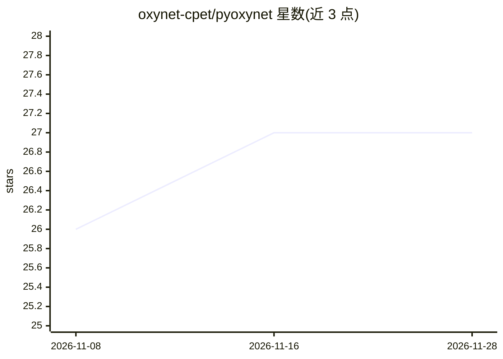

# oxynet-cpet/pyoxynet

⭐ 27 · Python · MIT · 推送 2026-11-23 · [GitHub](https://github.com/oxynet-cpet/pyoxynet) · [官网](https://oxynet-cpet.github.io/pyoxynet/) · 个人维护

**本地分析心肺运动测试数据的深度学习模型包，输出运动强度域与通气阈**

Oxynet 研究论文的开源模型 Python 包：输入逐秒或逐呼吸的 CPET 数据（VO2、VCO2、VE 等信号），返回中等/重度/极重运动强度域的逐秒输出及 VT1/VT2 通气阈位置；模型以冻结的 LiteRT 文件形式本地运行，无需 TensorFlow。另含条件 GAN 生成合成测试与 138 个匿名示例。提供 CNN 与 LSTM 两种模型。声明为研究软件而非诊断设备，不输出置信度，振荡通气分析处于 beta；面向运动科学/科研用户。

## 筛选速览

| 维度 | 判定 | 备注 |
|---|---|---|
| AI 角色 | `ai-native` | 本体是模型或模型工具 |
| 许可风险 | `permissive` | MIT |
| 部署形态 | `library` | 以包/库形式分发 |
| 模型依赖 | — | README 未给出锁定关系 |
| 硬件要求 | — | 无带数字的原话,不猜 |
| 安装摩擦 | `low` | 无编译、无系统依赖或容器化 |
| 成熟度 | `idea` | |

## 能力要点

- 逐秒输出三个运动强度域与 VT1/VT2 通气阈位置
- 模型为冻结 LiteRT 文件，本地推理无需 TensorFlow
- 条件 GAN 生成合成渐增测试（可设定 4 档体能水平），附 138 个匿名示例测试
- 兼容 Python 3.10-3.14，Windows/Linux/macOS（Apple silicon）

## 适用场景

- 分析自己的 CPET 数据，自动定位通气阈与强度域
- 生成合成测试数据用于方法开发或教学
- 复现 Oxynet 论文中的模型推理流程

## 场景标签

`科研工具` · 领域:学习与行业

## 证据(README 行号)

> L18: Give pyoxynet a test and it returns, second by second, the model's output for the moderate, heavy
> L19: and severe exercise-intensity domains, and the two ventilatory thresholds (VT1 and VT2) where those
> L128: pyoxynet includes a conditional generative adversarial network (GAN) that generates synthetic

## 星数曲线

2026-11-08 26 → 2026-11-28 27（+1）

---
*卡片 v1 · prompt 1.4 · 生成 2026-11-18 · 置信度 high · 依据 README sha `1aa8348b09c4` · [字段定义](../../DATASET.md)*
