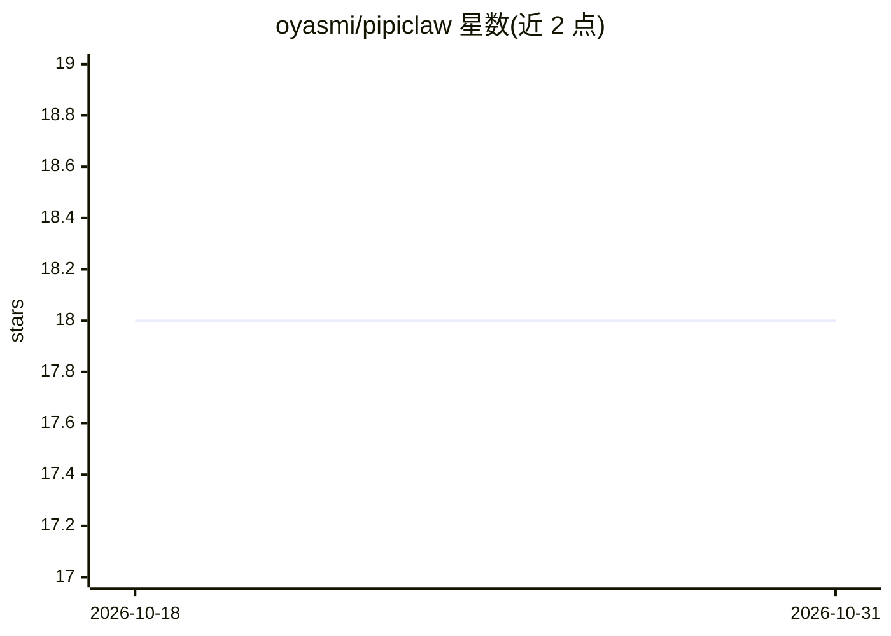

# oyasmi/pipiclaw

⭐ 18 · TypeScript · AGPL-3.0 · 推送 2026-10-30 · [GitHub](https://github.com/oyasmi/pipiclaw) · [官网](https://www.npmjs.com/package/@oyasmi/pipiclaw) · 个人维护 · 中文 README

**钉钉里的 AI coding 助手运行时：多智能体协作与长期任务**

面向个人与小团队的自托管 AI 助手运行时，把钉钉作为常驻工作入口：主智能体理解目标并交付，轻量子智能体处理检索整理，外部智能体（Claude Code、Codex CLI 或自定义脚本）承担跨文件实现与独立评审。支持长期记忆、按天日志、任务台账、定时事件与工位隔离；使用钉钉 Stream Mode 无需公网 IP，AI Card 实时显示状态。定位单实例运行，非强多租户 SaaS，不提供 OS 级沙箱。

## 筛选速览

| 维度 | 判定 | 备注 |
|---|---|---|
| AI 角色 | `ai-native` | 本体是模型或模型工具 |
| 许可风险 | `viral` | AGPL-3.0 |
| 部署形态 | `library` | 以包/库形式分发 |
| 模型依赖 | — | README 未给出锁定关系 |
| 硬件要求 | — | 无带数字的原话,不猜 |
| 安装摩擦 | `low` | 无编译、无系统依赖或容器化 |
| 成熟度 | — | 结构信号不足 |

## 能力要点

- 内置子智能体 + 外部 CLI 智能体（Claude Code / Codex CLI）双层委派
- 终端、钉钉私聊与多群共享长期记忆，工位机制实现隔离
- 钉钉 Stream Mode 接入，无需公网 IP，AI Card 持续显示执行状态
- 运行状态、用量、任务与委派均有不经过 LLM 的控制命令

## 适用场景

- 在钉钉群/私聊中长期跟进跨小时的编码、迁移与报告任务
- 把需求分析、实现、评审分派给不同 AI 智能体协作
- 以终端 TUI 模式本地使用同一助手并复用模型网关账号

## 场景标签

`Agent 记忆` `多智能体` `编码 Agent` `AI 助手` · 领域:Agent 开发

## 证据(README 行号)

> L7: Pipiclaw 是一个面向个人和团队的 AI coding assistant runtime。它让 AI 助手不只回答一轮问题，而是能留在你的钉钉里理解上下文、操作工作区、记住长期约定、按计划继续任务，还能把重活委派给 Clau
> L29: Pipiclaw 使用钉钉 Stream Mode，不需要自建消息中转服务或公网 IP。AI Card 可以持续显示思考、工具执行和状态更新；任务进行中仍可用 `/steer` 调整方向、`/followup` 排队下一件事、`/

## 星数曲线

2026-10-18 18 → 2026-10-31 18（+0）

---
*卡片 v1 · prompt 1.4 · 生成 2026-10-29 · 置信度 high · 依据 README sha `0753ab67e333` · [字段定义](../../DATASET.md)*
