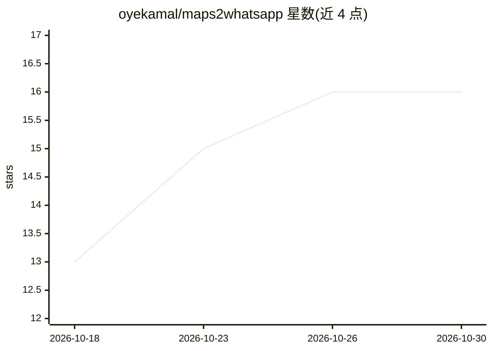

# oyekamal/maps2whatsapp

⭐ 16 · JavaScript · MIT · 推送 2026-09-14 · [GitHub](https://github.com/oyekamal/maps2whatsapp) · 个人维护

**给自由职业者的 Google Maps 获客+WhatsApp 群发工具（本地 AI 写稿）**

面向自由职业者与小代理的本地获客工具：按行业+城市抓取 Google Maps 商家名单（名称、电话、评分、网站），可经 Ollama 本地模型为每个商家生成个性化 WhatsApp 消息（也可用纯模板，无 Ollama 仍可运行），编辑确认后通过 Baileys（WhatsApp Web 协议）从用户自己的号码扫码发送。内置随机间隔、次数上限、去重日志等防封禁机制。Node.js 运行，无需 Docker、API key 或订阅，支持 Windows/macOS/Linux。

## 筛选速览

| 维度 | 判定 | 备注 |
|---|---|---|
| AI 角色 | `ai-enhanced` | 去掉 AI 部分产品仍成立 |
| 许可风险 | `permissive` | MIT |
| 部署形态 | `library` | 以包/库形式分发 |
| 模型依赖 | local-ok | 支持本地模型 |
| 硬件要求 | — | 无带数字的原话,不猜 |
| 安装摩擦 | `low` | 无编译、无系统依赖或容器化 |
| 成熟度 | — | 结构信号不足 |

## 能力要点

- Google Maps 抓取（gosom 二进制自动下载，快速模式无需浏览器）
- Ollama 本地模型按商家信息逐条改写消息，纯模板可作后备
- Baileys 扫码用自己的 WhatsApp 号码发送，会话保存
- 随机 45–120 秒间隔、每日上限、发送日志去重等防封禁机制

## 适用场景

- 每周寻找本地商家客户并批量发送个性化开发信
- 把 Google Maps 搜索—写稿—WhatsApp 发送流程在一个页面完成
- 在本地离线跑 AI 写稿，不把数据传出机器

## 场景标签

`网页抓取` `AI 写作` · 领域:效率与自动化

## 证据(README 行号)

> L25: - **Local LLM message drafting, per business** — Ollama + `llama3.2` (2 GB) writes a warm 40–70 word base message, 
> L3: **Free lead generation + WhatsApp outreach tool for freelancers and small agencies.** Type a business type

## 星数曲线

2026-10-18 13 → 2026-10-30 16（+3）

---
*卡片 v1 · prompt 1.4 · 生成 2026-10-30 · 置信度 high · 依据 README sha `feaa32765a16` · [字段定义](../../DATASET.md)*
