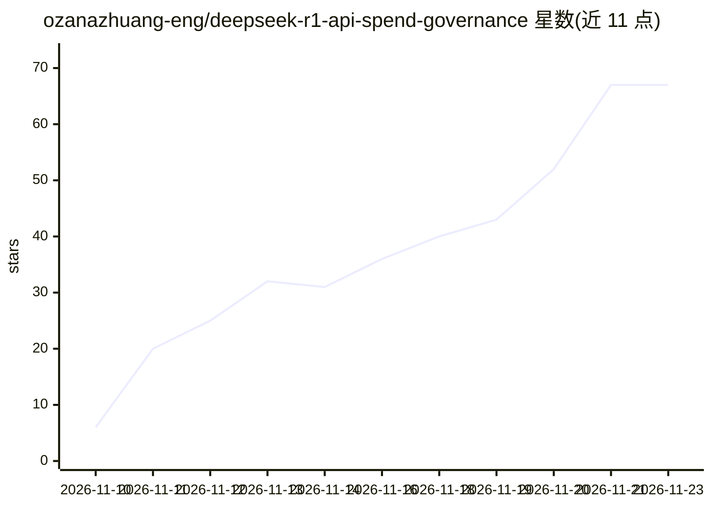

# ozanazhuang-eng/deepseek-r1-api-spend-governance

⭐ 67 · 推送 2026-11-10 · [GitHub](https://github.com/ozanazhuang-eng/deepseek-r1-api-spend-governance) · [官网](https://app.coregold.io/signup?invite_code=ADvlj9b) · 组织维护 · 中文 README

**推广 CoreGold 虚拟信用卡的 DeepSeek 托管 API 付款指南**

以“实战指南”形式撰写的营销文档：先描述第三方算力平台（Together AI、Fireworks AI、DeepInfra、RunPod）Auto-Topup 结算触发国内银行风控锁卡、超额透支等付款问题，再给出注册 CoreGold、USDT 充值、开卡、绑卡的三步图文流程。仓库不含代码或可安装产物，正文多处放置 CoreGold 官方控制台入口链接，属于商业推广内容而非软件项目。

## 筛选速览

| 维度 | 判定 | 备注 |
|---|---|---|
| AI 角色 | `ai-knowledge` | 知识聚合/清单类 |
| 许可风险 | `none` | — |
| 部署形态 | `None` |  |
| 模型依赖 | — | README 未给出锁定关系 |
| 硬件要求 | — | 无带数字的原话,不猜 |
| 安装摩擦 | `low` | 无编译、无系统依赖或容器化 |
| 成熟度 | — | 结构信号不足 |

## 能力要点

- 以教程形式描述第三方托管 API 平台的扣费与风控问题
- 给出 CoreGold 开卡、USDT 充值与绑卡的三步操作流程
- 文中多处插入 CoreGold 官方控制台注册链接

## 适用场景

- 了解第三方算力平台 Auto-Topup 结算可能触发的付款风控问题
- 按步骤注册并使用 CoreGold 虚拟信用卡

## 场景标签

 · 领域:金融支付/营销内容

## 证据(README 行号)

> L2: ⚡ 2026 实战指南：手把手教你用 CoreGold 商业 VCC 搞定 DeepSeek 海外托管 API 结算
> L7: 👉 **立即进入 CoreGold 官方开卡控制台**
> L53: 👉 **点击注册并进入 CoreGold 官方发卡后台**

## 星数曲线

2026-11-10 6 → 2026-11-23 67（+61）

---
*卡片 v1 · prompt 1.4 · 生成 2026-11-18 · 置信度 mid · 依据 README sha `de59dbe5fff6` · [字段定义](../../DATASET.md)*
