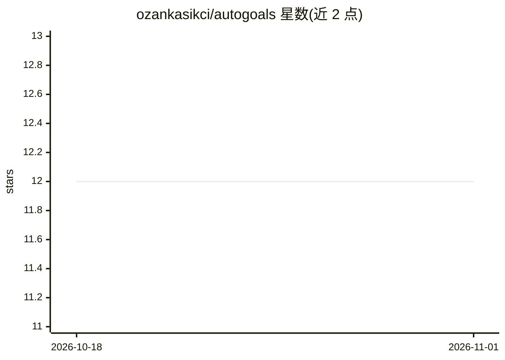

# ozankasikci/autogoals

⭐ 12 · TypeScript · MIT · 推送 2026-03-23 · [GitHub](https://github.com/ozankasikci/autogoals) · 个人维护

**管理自主 AI 编码 agent 的目标驱动开发平台**

开源平台，基于 Claude Code SDK 管理自主编码 agent：用户定义带验收标准的目标，agent 持续规划、写代码、运行验证、自动 git 提交检查点并进入下一目标，全部通过实时仪表盘管理。提供 Interview/Auto-Plan 两种规划模式、实时聊天干预、全局与项目级规则系统及周期性合规检查、开发服务器进程管理、循环目标等功能。每个任务给 agent 新建上下文窗口以避免长会话质量下降。技术栈为 TypeScript、React、GraphQL、SQLite，npm 全局安装，需 Node.js 18+ 与 Claude Code CLI。

## 筛选速览

| 维度 | 判定 | 备注 |
|---|---|---|
| AI 角色 | `ai-ecosystem` | LLM/agent 周边工具 |
| 许可风险 | `permissive` | MIT |
| 部署形态 | `library` | 以包/库形式分发 |
| 模型依赖 | locked-api |  |
| 硬件要求 | — | 无带数字的原话,不猜 |
| 安装摩擦 | `low` | 无编译、无系统依赖或容器化 |
| 成熟度 | — | 结构信号不足 |

## 能力要点

- 目标驱动执行：agent 规划、编码、验证并自动 git 提交检查点
- Interview/Auto-Plan 两种规划模式
- 全局与项目级规则系统及周期性合规检查
- 每个目标独立 agent 会话避免上下文劣化

## 适用场景

- 定义项目目标让 AI agent 持续自主完成开发任务
- 通过实时聊天纠正或引导正在工作的 agent
- 用循环目标做持续测试、lint 或监控任务

## 场景标签

`编码 Agent` · 领域:编码与开发

## 证据(README 行号)

> L12: AutoGoals is an open-source platform that manages autonomous AI coding agents. You define goals for your project, a
> L14: It uses Claude Code SDK under the hood, giving each agent a fresh context window per task to prevent quality degrad

## 星数曲线

2026-10-18 12 → 2026-11-01 12（+0）

---
*卡片 v1 · prompt 1.4 · 生成 2026-11-01 · 置信度 high · 依据 README sha `a01dfc62295a` · [字段定义](../../DATASET.md)*
