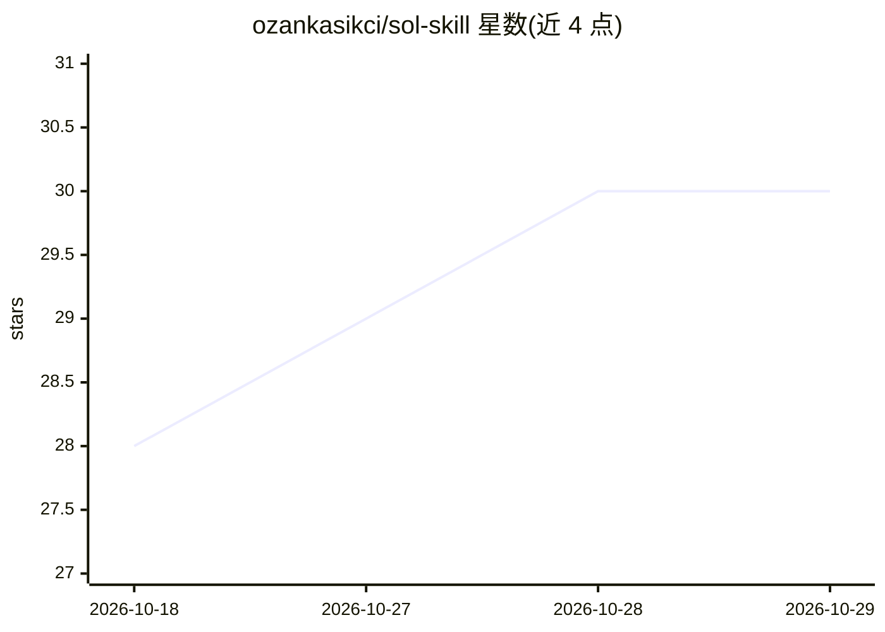

# ozankasikci/sol-skill

⭐ 30 · Python · MIT · 推送 2026-10-05 · [GitHub](https://github.com/ozankasikci/sol-skill) · 个人维护

**Claude Code 技能：Claude 规划与审查、GPT Sol 经 Codex CLI 写代码**

一个 Claude Code skill，实现双模型分工的 AI 编码流程：Claude（用户会话）只写任务简报并审查 diff、亲自重跑测试；GPT-6.1 Sol 通过 OpenAI Codex CLI 实施全部代码改动。核心机制是规划者/实现者角色分离、XML 结构化简报契约、编号可验证的验收标准、最多 2 轮修正、经 supervised launcher 后台运行并带 watchdog，支持多 worker 并行（各自 git worktree）。限制：仅显式 /sol 触发，Codex CLI 需另行 npm 安装与登录，高推理档运行耗时较长（文档记载单文件改动 8 分钟）。

## 筛选速览

| 维度 | 判定 | 备注 |
|---|---|---|
| AI 角色 | `ai-ecosystem` | LLM/agent 周边工具 |
| 许可风险 | `permissive` | MIT |
| 部署形态 | `library` | 以包/库形式分发 |
| 模型依赖 | locked-api |  |
| 硬件要求 | — | 无带数字的原话,不猜 |
| 安装摩擦 | `low` | 无编译、无系统依赖或容器化 |
| 成熟度 | — | 结构信号不足 |

## 能力要点

- Claude 规划/审查与 Sol 实现的角色分离，实现模型不自我评审
- XML 块结构化简报契约与编号可验证验收标准
- launcher 带 watchdog、summary.json 结构化报告，修正上限 2 轮
- 多 worker 并行任务（各自 git worktree，合并后统一重跑检查）

## 适用场景

- 让不同厂商模型分别负责规划与实现，降低单模型自评偏差
- 在 Claude Code 中以 /sol 委托代码实现并自动审查 diff
- 并行处理多个独立编码任务并合并验证

## 场景标签

`编码 Agent` `多智能体` `代码审查` · 领域:Agent 开发

## 证据(README 行号)

> L8: A Claude Code skill for multi-model AI coding: Claude writes the brief and reviews the real diff, while GPT-6.1 Sol 
> L42: Claude writes the brief → Sol implements → Claude reviews the real diff and re-runs your tests before telling you i
> L44:  Other hosts (Cursor, Copilot, Gemini CLI, ~50 more): `npx skills add ozankasikci/sol-skill -g`. Requirements, a pr

## 星数曲线

2026-10-18 28 → 2026-10-29 30（+2）

---
*卡片 v1 · prompt 1.4 · 生成 2026-10-26 · 置信度 high · 依据 README sha `1e8f2b8e77bf` · [字段定义](../../DATASET.md)*
