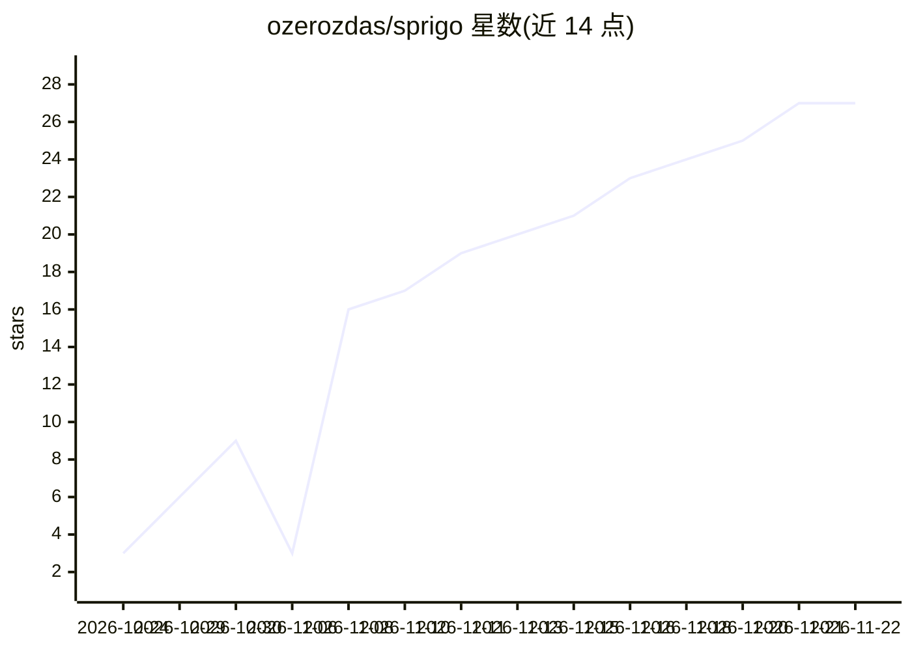

# ozerozdas/sprigo

⭐ 27 · TypeScript · MIT · 推送 2026-11-20 · [GitHub](https://github.com/ozerozdas/sprigo) · [官网](https://mehmetozer.dev/sprigo) · 个人维护

**本地运行的桌面语言学习应用，AI 生成课程与对话练习**

面向语言学习者的免费开源桌面应用（Duolingo 替代），课程覆盖英/西/法/德/土/匈语 A1→C2。课程、故事与实时对话练习由本地模型（Ollama 或 LM Studio）生成，也可用 OpenAI/Anthropic/Gemini/OpenRouter API key。语音识别内置 whisper.cpp，可选 Piper/Kokoro 本地语音合成；进度存于本地 SQLite，数据不出本机。提供 macOS（Homebrew/安装包）、Windows 安装包与 .deb/.rpm 包。

## 筛选速览

| 维度 | 判定 | 备注 |
|---|---|---|
| AI 角色 | `ai-native` | 本体是模型或模型工具 |
| 许可风险 | `permissive` | MIT |
| 部署形态 | `desktop` | 安装包/桌面程序 |
| 模型依赖 | local-ok | 支持本地模型 |
| 硬件要求 | — | 无带数字的原话,不猜 |
| 安装摩擦 | `low` | 无编译、无系统依赖或容器化 |
| 成熟度 | — | 结构信号不足 |

## 能力要点

- 6 门语言课程，A1→C2 结构化路径，课程内容由本地 LLM 生成
- 视频通话式实时对话课，含字幕、口语评估与即时纠错
- 内置 whisper.cpp 语音识别，Piper/Kokoro 本地语音合成
- 本地 SQLite 存储、系统钥匙串保存 API key、支持多用户配置

## 适用场景

- 在本机离线学外语，不注册账号不上传数据
- 与 AI 导师实时对话练习口语并获得纠正
- 通过手机浏览器经 Tailscale 远程使用桌面上的实例

## 场景标签

`教程课程` `语音 Agent` · 领域:对话与助手

## 证据(README 行号)

> L5:  A free, open-source Duolingo alternative that runs on your own computer. Lessons, stories and live conversation pra
> L37: - **Live lesson:** a video-call style lesson with one of six animated tutors who talks with you, with live captions

## 星数曲线

2026-10-24 3 → 2026-11-22 27（+24）

---
*卡片 v1 · prompt 1.4 · 生成 2026-11-18 · 置信度 high · 依据 README sha `1515ce315177` · [字段定义](../../DATASET.md)*
