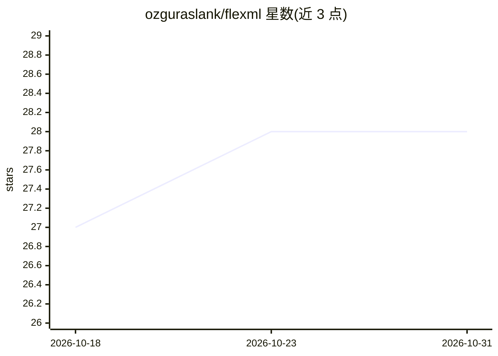

# ozguraslank/flexml

⭐ 28 · Python · Apache-2.0 · 推送 2026-01-24 · [GitHub](https://github.com/ozguraslank/flexml) · 个人维护

**Python AutoML 库：自动完成模型选择与超参数调优**

面向回归与分类任务的 Python AutoML 库，自动化模型选择与超参数调优。提供 'quick' 与 'wide' 两种实验模式，前者仅训练常用机器学习模型以加快速度，后者训练库内全部模型。实验结束后生成模型排行榜，可通过 get_best_models() 获取最优模型，并支持 tune_model() 调优后更新榜单。仓库 notebooks 文件夹提供 Jupyter Notebook 用法示例，仅支持英文文档，安装方式为 pip install flexml。

## 筛选速览

| 维度 | 判定 | 备注 |
|---|---|---|
| AI 角色 | `ai-native` | 本体是模型或模型工具 |
| 许可风险 | `permissive` | Apache-2.0 |
| 部署形态 | `library` | 以包/库形式分发 |
| 模型依赖 | — | README 未给出锁定关系 |
| 硬件要求 | — | 无带数字的原话,不猜 |
| 安装摩擦 | `low` | 无编译、无系统依赖或容器化 |
| 成熟度 | — | 结构信号不足 |

## 能力要点

- 自动模型选择与超参数调优
- quick/wide 两种实验模式控制实验规模
- 模型排行榜与 get_best_models() 获取最优模型
- 支持回归与分类任务

## 适用场景

- 回归任务上快速尝试多个模型并获取排行榜
- 分类任务中自动调参并选出最优模型
- 通过 notebook 示例学习库的用法

## 场景标签

`MLOps` · 领域:训练与推理

## 证据(README 行号)

> L8: FlexML is an easy-to-use and flexible AutoML library for Python that simplifies the process of building machine lear
> L9: At the moment, FlexML supports only regression and classification tasks and offers two experiment modes; 'quick' and

## 星数曲线

2026-10-18 27 → 2026-10-31 28（+1）

---
*卡片 v1 · prompt 1.4 · 生成 2026-10-26 · 置信度 high · 依据 README sha `ee486f816c59` · [字段定义](../../DATASET.md)*
