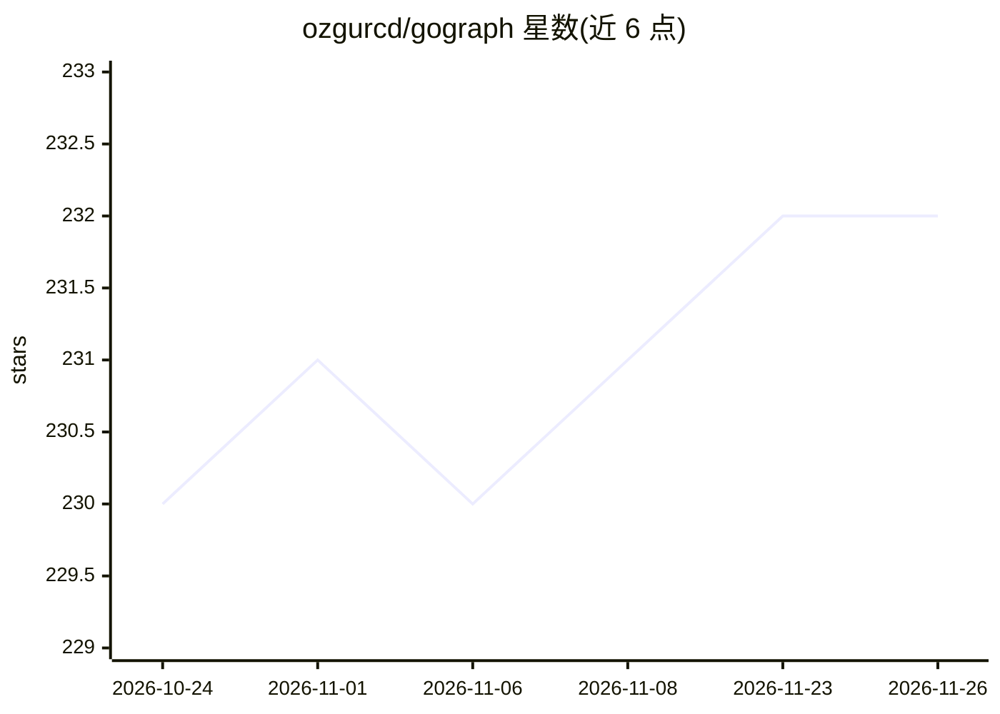

# ozgurcd/gograph

⭐ 232 · Go · MIT · 推送 2026-11-25 · [GitHub](https://github.com/ozgurcd/gograph) · [官网](https://gograph.identuum.ai) · 个人维护

**Go 代码静态分析 CLI，向 AI agent 提供 MCP 接口**

面向 Go 仓库的本地静态分析命令行工具：将代码索引为 AST 与可选类型检查（CHA/SSA）图，提供调用链追踪、传递影响面分析、基于变更的测试选择、Mermaid 依赖图渲染，以及包边界/复杂度/API 漂移等 CI 架构门禁。内置 stdio MCP 服务器（70 个工具），供编码 agent 在本地读取仓库结构化分析结果；不执行目标代码、不外传源码。安装方式包括 Homebrew cask 与 go install。

## 筛选速览

| 维度 | 判定 | 备注 |
|---|---|---|
| AI 角色 | `ai-enhanced` | 去掉 AI 部分产品仍成立 |
| 许可风险 | `permissive` | MIT |
| 部署形态 | `library` | 以包/库形式分发 |
| 模型依赖 | — | README 未给出锁定关系 |
| 硬件要求 | — | 无带数字的原话,不猜 |
| 安装摩擦 | `low` | 无编译、无系统依赖或容器化 |
| 成熟度 | — | 结构信号不足 |

## 能力要点

- 内置 stdio MCP 服务器，66 个仓库查询/分析命令加 4 个会话工具（共 70 个项目工具）
- 基于 AST/CHA/SSA 的调用图、传递影响面与变更范围测试选择
- CI 架构门禁：包导入分层、复杂度/不稳定性限值、API 漂移检测
- 源到汇的安全流追踪（HTTP/JSON/环境变量到 SQL、进程执行、文件系统等）

## 适用场景

- 在 CI 中强制执行 Go 包导入边界与复杂度门禁
- 为未提交的代码变更选出需要运行的 go test 命令
- 让 Claude Code 等 MCP 客户端在本地查询仓库调用图与影响面
- 追踪从输入源到 SQL/进程/文件系统汇点的进程间路径

## 场景标签

 · 领域:开发者工具/代码分析

## 证据(README 行号)

> L9: **Local Go static analysis, call-graph, blast-radius, and CI architecture-gate CLI—with a built-in stdio MCP server 
> L153: ## Built-In MCP Server and AI Agent Integration
> L59: > **Local-only analysis:** `gograph` does not execute target code or transmit source or telemetry to external servi

## 星数曲线

2026-10-24 230 → 2026-11-26 232（+2）

---
*卡片 v1 · prompt 1.4 · 生成 2026-11-26 · 置信度 high · 依据 README sha `b75d37edfb96` · [字段定义](../../DATASET.md)*
