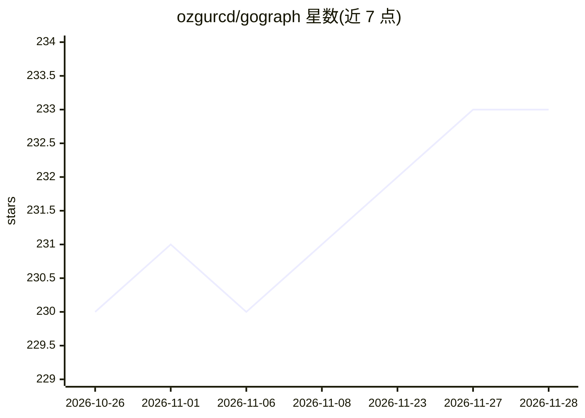

# ozgurcd/gograph

⭐ 233 · Go · MIT · 推送 2026-11-26 · [GitHub](https://github.com/ozgurcd/gograph) · [官网](https://gograph.identuum.ai) · 个人维护

**Go 代码静态分析 CLI，经内置 MCP 服务供 AI 代理查询调用图与影响面**

面向 Go 仓库的本地静态分析工具：将代码索引进 AST 及可选类型检查（CHA/SSA）图，支持追踪传递调用者、为未提交变更选择测试、渲染 Mermaid 依赖图、用 CI 架构门禁强制包边界，全部本地运行，不执行目标代码、不外传源码。内置 stdio MCP 服务器，将 66 项查询能力以 project MCP 工具形式暴露给编码代理，并可选记录代理的 plan/review 合规审计。通过 Homebrew cask 或 go install 安装。

## 筛选速览

| 维度 | 判定 | 备注 |
|---|---|---|
| AI 角色 | `ai-enhanced` | 去掉 AI 部分产品仍成立 |
| 许可风险 | `permissive` | MIT |
| 部署形态 | `library` | 以包/库形式分发 |
| 模型依赖 | — | README 未给出锁定关系 |
| 硬件要求 | — | 无带数字的原话,不猜 |
| 安装摩擦 | `low` | 无编译、无系统依赖或容器化 |
| 成熟度 | — | 结构信号不足 |

## 能力要点

- AST + 类型检查（CHA/SSA）调用图与 blast-radius 分析，支持 --mermaid/--json 导出
- 内置 stdio MCP 服务器：66 项仓库查询能力 + 4 个会话生命周期工具
- 变更范围测试选择与未覆盖行报告，CI 架构/策略门禁（boundaries/gate/api drift）
- 本地安全流分析：HTTP/JSON/环境变量到 SQL、进程执行、文件系统等 sink 的源到汇路径

## 适用场景

- 在 CI 中强制 Go 项目的包导入分层与复杂度阈值
- 提交前评估改动的影响面并生成需运行的测试命令
- 让 Claude Code 等编码代理通过 MCP 查询精确的调用图证据
- 追踪从请求入口到危险 sink 的跨过程安全路径

## 场景标签

 · 领域:开发者工具/代码分析

## 证据(README 行号)

> L9: **Local Go static analysis, call-graph, blast-radius, and CI architecture-gate CLI—with a built-in stdio MCP server 
> L86: **Built-In Native MCP Server** — all 66 repository query, analysis, and workflow capabilities have project-MCP equi
> L153: ## Built-In MCP Server and AI Agent Integration

## 星数曲线

2026-10-26 230 → 2026-11-28 233（+3）

---
*卡片 v1 · prompt 1.4 · 生成 2026-11-27 · 置信度 high · 依据 README sha `f8c064bf442c` · [字段定义](../../DATASET.md)*
