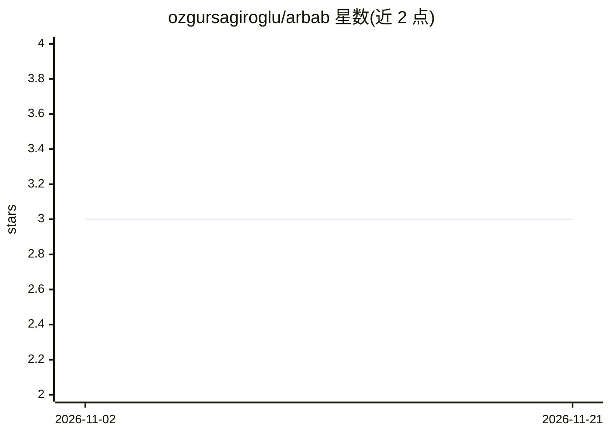

# ozgursagiroglu/arbab

⭐ 3 · TypeScript · MIT · 推送 2026-11-10 · [GitHub](https://github.com/ozgursagiroglu/arbab) · [官网](https://ozgursagiroglu.github.io/arbab/) · 个人维护

**Claude Code 插件：把会话拆成并行 headless worker 工程队**

arbab 是一个 Claude Code 插件：把大型工程任务拆分为独立 lane，每个 lane 由未修改的 claude 二进制以 headless 方式在独立 git worktree 与沙箱 fence 内并行执行，带预算与时钟、配额感知启动和使用限额自动恢复；随后在 fence 内验证、对抗式审查并生成 readiness 报告，仅在用户确认后合入（从不 push）。依赖 Claude Code 2.1.290+、Node.js 20+ 与 git，沙箱在 macOS 上测试，Linux 未测试。零运行时依赖，依赖变更须用户本人在终端确认。

## 筛选速览

| 维度 | 判定 | 备注 |
|---|---|---|
| AI 角色 | `ai-ecosystem` | LLM/agent 周边工具 |
| 许可风险 | `permissive` | MIT |
| 部署形态 | `None` |  |
| 模型依赖 | locked-api |  |
| 硬件要求 | — | 无带数字的原话,不猜 |
| 安装摩擦 | `low` | 无编译、无系统依赖或容器化 |
| 成熟度 | — | 结构信号不足 |

## 能力要点

- 每个 lane 一个 brief、一个 worker、一个 worktree，按依赖波次并行执行
- 沙箱 fence 内验证、审查与就绪报告流水线，worker 代码不在宿主直接运行
- 配额感知启动与用量限额自动恢复
- land 命令需人工确认，hook 永不批准，且从不 push

## 适用场景

- 在交互式 Claude Code 会话中并行委派多个独立子任务
- 让 AI 生成的代码在沙箱中先验证与审查再由人工决定合入
- 控制并行 worker 数量与用量配额以适配订阅限额

## 场景标签

`多智能体` `编码 Agent` `代码审查` · 领域:Agent 开发

## 证据(README 行号)

> L13: Claude Code plugin
> L42: - **The arbab runner** does the mechanics: worktrees, sandbox profiles, quota holds, auto-resume, integration, fenc
> L82: - Claude Code 2.1.290 or newer;

## 星数曲线

2026-11-02 3 → 2026-11-21 3（+0）

---
*卡片 v1 · prompt 1.4 · 生成 2026-11-21 · 置信度 high · 依据 README sha `b9cf6f9df869` · [字段定义](../../DATASET.md)*
