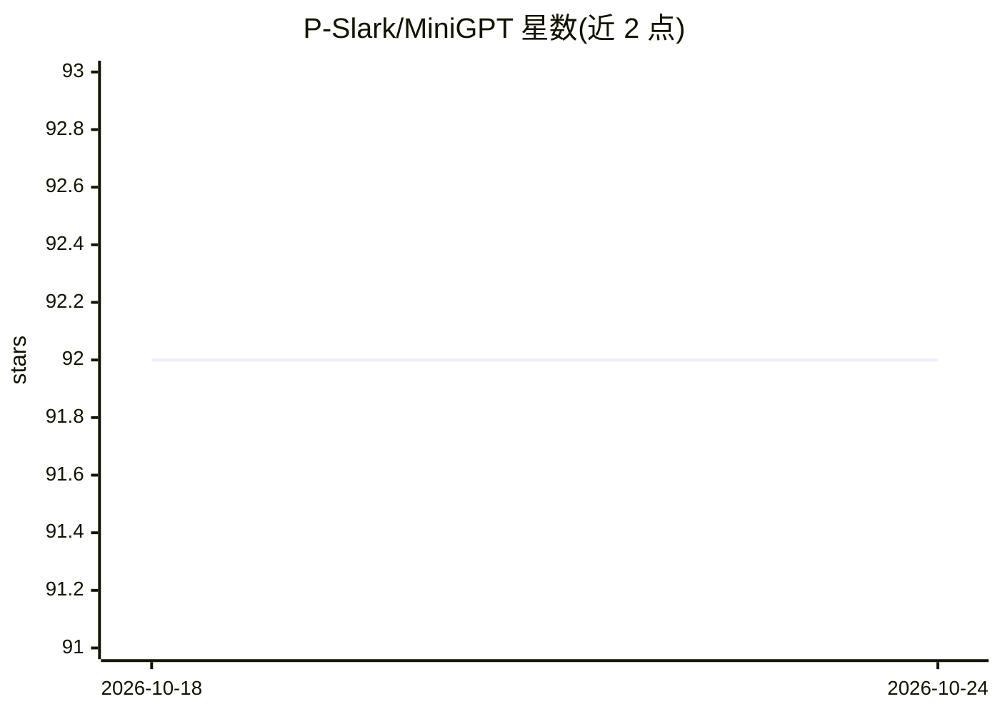

# P-Slark/MiniGPT

⭐ 92 · Python · MIT · 推送 2026-05-29 · [GitHub](https://github.com/P-Slark/MiniGPT) · 个人维护

**从零用 PyTorch 逐模块实现小型 LLM 的学习型代码库与历程记录**

受斯坦福 CS336 课程启发的个人学习项目：不依赖 transformers 库和预训练权重，仅用 PyTorch 张量运算与 autograd，从零实现 BPE 分词器（并行+增量）、Transformer（RMSNorm/RoPE/SwiGLU/MHA/共享词嵌入）、AdamW 与余弦学习率调度、梯度裁剪、训练循环（含 checkpoint）及采样生成（temperature/top-k/top-p）。每章 JOURNEY.md 记录尝试过程与各轮优化的收益，章节与 commit 对应。状态标注为 WIP，需 Python 3.12+ 与 PyTorch ~2.11，通过 uv 管理环境。

## 筛选速览

| 维度 | 判定 | 备注 |
|---|---|---|
| AI 角色 | `ai-native` | 本体是模型或模型工具 |
| 许可风险 | `permissive` | MIT |
| 部署形态 | `library` | 以包/库形式分发 |
| 模型依赖 | — | README 未给出锁定关系 |
| 硬件要求 | — | 无带数字的原话,不猜 |
| 安装摩擦 | `low` | 无编译、无系统依赖或容器化 |
| 成熟度 | `idea` | |

## 能力要点

- BPE 分词器、Transformer、AdamW、训练循环、采样生成全部从零实现
- JOURNEY.md 按章节记录实现路径与优化收益，与 commit 一一对应
- 不使用 torch.nn.Transformer、HuggingFace、transformers 库与预训练权重

## 适用场景

- 跟着 JOURNEY.md 逐步理解 LLM 各组件的实现原理
- 作为 CS336 课程的学习参考与实现对照
- 阅读短小模块源码学习 BPE/RoPE/SwiGLU 等细节

## 场景标签

`教程课程` `模型训练` · 领域:学习与行业

## 证据(README 行号)

> L24: **The code.** Clean, dependency-light implementations of every piece: BPE tokenizer, RMSNorm/RoPE/SwiGLU/MHA, AdamW
> L35: - **🧱 Built from PyTorch primitives, not framework abstractions.** No `torch.nn.Transformer`, no HuggingFace, no `t
> L46: |V|Text generation (temperature, top-k, top-p, EOS stopping)|`cs336_basics/decoding.py`, `scripts/generate.py`|Part

## 星数曲线

2026-10-18 92 → 2026-10-24 92（+0）

---
*卡片 v1 · prompt 1.4 · 生成 2026-10-23 · 置信度 mid · 依据 README sha `45fe0c3433f9` · [字段定义](../../DATASET.md)*
