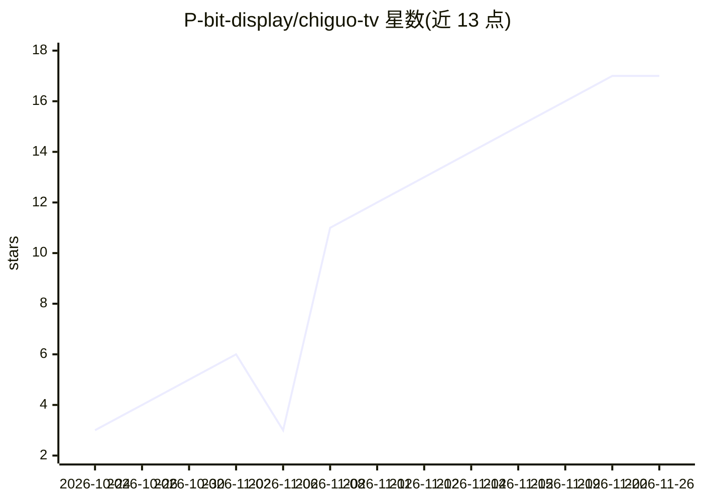

# P-bit-display/chiguo-tv

⭐ 17 · Shell · MIT · 推送 2026-11-14 · [GitHub](https://github.com/P-bit-display/chiguo-tv) · 个人维护 · 中文 README

**红米/小米电视去广告调优方案：tvOS 风格桌面与家庭影音部署**

面向红米/小米 Android TV 用户的免 Root 电视系统改造方案：通过无线 ADB 一键清理系统广告与预装组件、替换 Aerial TV 桌面、动画调速与 AOT 预编译、部署 Jellyfin/Immich/IPTV/SmartTube 应用生态，并配置 FlClash 白名单分流解决 TUN 阻断 IPv6 问题。提供 Windows/macOS 双击安装脚本、Agent Skill 自动化部署与 curl 单行安装三种方式，鸿蒙电视不支持。

## 筛选速览

| 维度 | 判定 | 备注 |
|---|---|---|
| AI 角色 | `ai-enhanced` | 去掉 AI 部分产品仍成立 |
| 许可风险 | `permissive` | MIT |
| 部署形态 | `None` |  |
| 模型依赖 | — | README 未给出锁定关系 |
| 硬件要求 | — | 无带数字的原话,不猜 |
| 安装摩擦 | `low` | 无编译、无系统依赖或容器化 |
| 成熟度 | — | 结构信号不足 |

## 能力要点

- 一键清理 18 项系统广告与预装组件，无需 Root、安全可逆
- Aerial TV 桌面替换 + 114 个 Apple TV 4K 航拍屏保
- FlClash 应用白名单分流，解决 TUN 阻断 IPv6 问题
- 提供 Agent Skill（SKILL.md）供 AI 终端自动化部署

## 适用场景

- 把红米/小米电视改造成无广告的 tvOS 风格影音中枢
- 在 Android TV 上搭建 Jellyfin 家庭影院与 IPTV 直播
- 配置仅 SmartTube 走代理、内网与 IPv6 直连的分流方案

## 场景标签

 · 领域:消费电子/电视系统调优

## 证据(README 行号)

> L10:  将充斥开机广告与臃肿后台的红米/小米电视，重塑为纯净、丝滑、极具 Apple TV 美学的高阶私有家庭影音中枢。
> L99: #### 方式 B：AI Agent 自动化部署（Antigravity / Claude Code / Cursor）

## 星数曲线

2026-10-24 3 → 2026-11-26 17（+14）

---
*卡片 v1 · prompt 1.4 · 生成 2026-11-18 · 置信度 high · 依据 README sha `53dae3579b37` · [字段定义](../../DATASET.md)*
