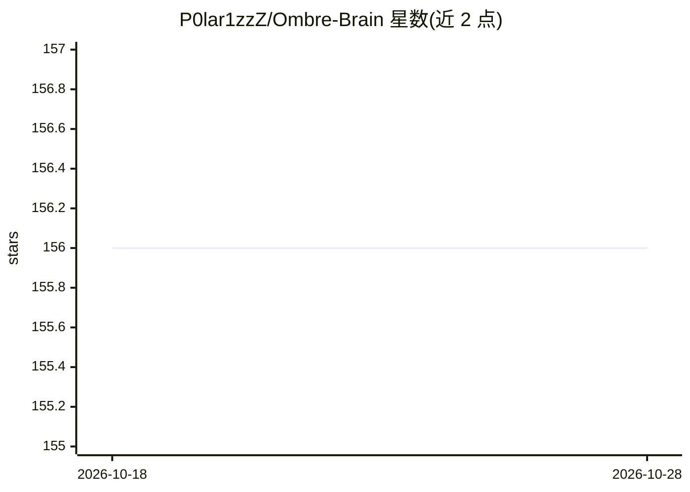

# P0lar1zzZ/Ombre-Brain

⭐ 156 · Python · MIT · 推送 2026-04-06 · [GitHub](https://github.com/P0lar1zzZ/Ombre-Brain) · 个人维护 · 中文 README

**给 Claude 用的长期情绪记忆 MCP 服务器，基于 Obsidian 存储**

通过 MCP 协议接入 Claude Desktop/Claude.ai 的长期记忆服务：每条记忆按 Russell 效价/唤醒度连续坐标打标，以 Obsidian 兼容的 Markdown 文件（YAML frontmatter）存储，支持自动注入双链。提供 5 个 MCP 工具（breath/hold/grow/trace/pulse）实现记忆存储、检索、浮现与归档；采用改进艾宾浩斯遗忘曲线做衰减，高唤醒记忆衰减更慢。记忆脱水与打标优先走廉价 LLM API（如 DeepSeek），API 不可用时降级为本地关键词分析。支持 Docker、Render、Zeabur 部署。

## 筛选速览

| 维度 | 判定 | 备注 |
|---|---|---|
| AI 角色 | `ai-ecosystem` | LLM/agent 周边工具 |
| 许可风险 | `permissive` | MIT |
| 部署形态 | `self-host` | docker 或自建部署 |
| 模型依赖 | local-ok | 支持本地模型 |
| 硬件要求 | — | 无带数字的原话,不猜 |
| 安装摩擦 | `low` | 无编译、无系统依赖或容器化 |
| 成熟度 | — | 结构信号不足 |

## 能力要点

- Russell 效价/唤醒度两维连续坐标情感打标
- 改进艾宾浩斯遗忘曲线：高唤醒记忆衰减更慢，pinned 桶不衰减
- 记忆以 Obsidian 兼容 Markdown 存储，可直接浏览编辑
- LLM API 不可用时自动降级为本地关键词分析

## 适用场景

- 让 Claude 跨对话保留与我的聊天经历和未解决事项
- 在 Obsidian 中直接查看和编辑记忆桶
- 远程部署后从 Claude.ai 网页版接入记忆服务

## 场景标签

`Agent 记忆` · 领域:Agent 开发

## 证据(README 行号)

> L3: 一个给提供给Claude 用的长期情绪记忆系统。基于 Russell 效价/唤醒度坐标打标，Obsidian 做存储层，MCP 接入，带遗忘曲线。
> L53: Claude ←→ MCP Protocol ←→ server.py
> L59: 5 个 MCP 工具 / 5 MCP tools:

## 星数曲线

2026-10-18 156 → 2026-10-28 156（+0）

---
*卡片 v1 · prompt 1.4 · 生成 2026-10-22 · 置信度 high · 依据 README sha `5ac9fc49a546` · [字段定义](../../DATASET.md)*
