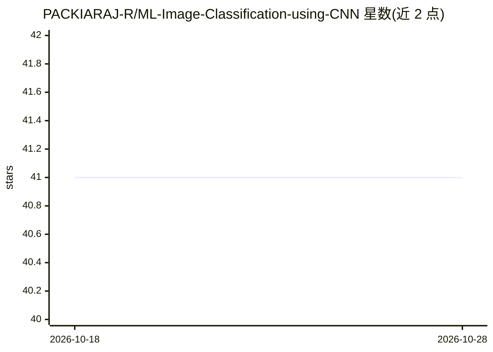

# PACKIARAJ-R/ML-Image-Classification-using-CNN

⭐ 41 · Jupyter Notebook · MIT · 推送 2026-01-31 · [GitHub](https://github.com/PACKIARAJ-R/ML-Image-Classification-using-CNN) · 个人维护

**CNN 图像分类教学项目：训练、评估并可视化结果**

基于 TensorFlow/Keras 的卷积神经网络图像分类示例项目，包含数据预处理、模型训练、评估与结果可视化（准确率曲线、混淆矩阵）。以单个 Jupyter Notebook 形式提供全部训练与评估代码，数据集来自 Kaggle。安装方式为依据 requirements.txt 安装依赖后运行 notebook。README 未说明具体分类类别数、模型结构细节或准确率数值。

## 筛选速览

| 维度 | 判定 | 备注 |
|---|---|---|
| AI 角色 | `ai-native` | 本体是模型或模型工具 |
| 许可风险 | `permissive` | MIT |
| 部署形态 | `None` |  |
| 模型依赖 | — | README 未给出锁定关系 |
| 硬件要求 | — | 无带数字的原话,不猜 |
| 安装摩擦 | `low` | 无编译、无系统依赖或容器化 |
| 成熟度 | — | 结构信号不足 |

## 能力要点

- 以单个 Jupyter Notebook 覆盖训练与评估流程
- 输出准确率曲线与混淆矩阵等性能指标
- 技术栈为 Python + TensorFlow/Keras + NumPy + Matplotlib

## 适用场景

- 学习 CNN 图像分类的完整训练与评估流程
- 作为图像分类的入门代码模板复用

## 场景标签

`教程课程` `目标检测` · 领域:学习与行业

## 证据(README 行号)

> L3: This project demonstrates an image classification system built using a Convolutional Neural Network (CNN).
> L6: The model is trained to classify images into different categories using deep learning techniques.

## 星数曲线

2026-10-18 41 → 2026-10-28 41（+0）

---
*卡片 v1 · prompt 1.4 · 生成 2026-10-25 · 置信度 high · 依据 README sha `999953623232` · [字段定义](../../DATASET.md)*
