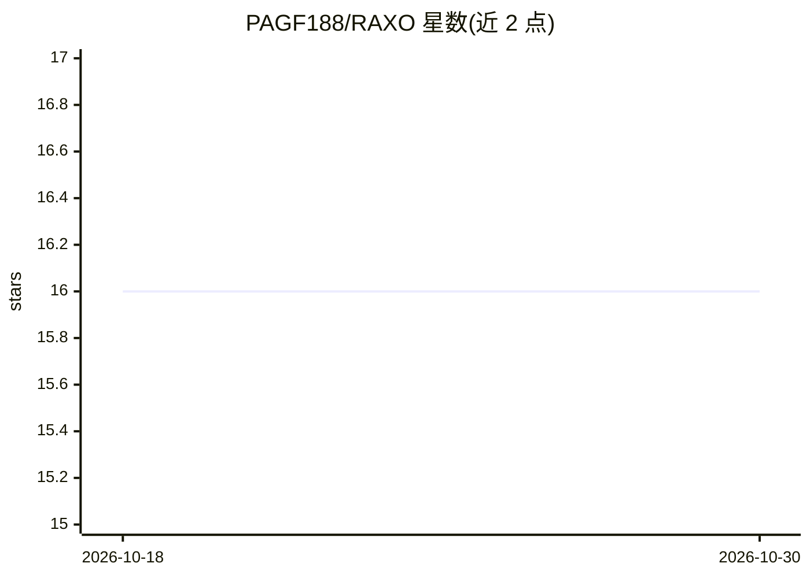

# PAGF188/RAXO

⭐ — · [GitHub]() · 组织维护

**免训练框架：将 RGB 开放词汇检测器迁移到 X 射线安检场景**

ICCV 2025 论文官方仓库。提出 RAXO，一个 training-free 框架，通过双源检索策略（内部图像描述子与网络检索图像经 X 射线材质迁移增强）构建视觉类别描述子，替代文本分类，将现成 RGB 开放词汇检测器（G-DINO、VLDet、Detic、CoDet）复用于 X 射线检测。配套发布 DET-COMPASS 基准（300+ 类别框标注）。安装方式为 git clone 源码加 Docker 镜像，需下载 6 个数据集；网页描述子计算需 Google Custom Search API 与 GPT-4 API key。

## 筛选速览

| 维度 | 判定 | 备注 |
|---|---|---|
| AI 角色 | `ai-native` | 本体是模型或模型工具 |
| 许可风险 | `none` | — |
| 部署形态 | `None` |  |
| 模型依赖 | — | README 未给出锁定关系 |
| 硬件要求 | — | 无带数字的原话,不猜 |
| 安装摩擦 | `low` | 无编译、无系统依赖或容器化 |
| 成熟度 | — | 结构信号不足 |

## 能力要点

- 免训练复用 RGB OvOD 检测器做 X 射线检测
- 双源检索构建视觉描述子，替代文本分类
- 配套发布 DET-COMPASS 基准（300+ 类别标注）
- 提供预计算描述子与初始检测结果

## 适用场景

- 在 X 射线安检图像上运行开放词汇物体检测
- 复现论文实验或在大规模 X 射线基准上评测
- 研究跨模态（RGB→X 射线）检测迁移方法

## 场景标签

`目标检测` `模型评测` `网络安全` · 领域:评测与运维

## 证据(README 行号)

> L24: To overcome these limitations, we propose **RAXO**, a training-free framework that repurposes off-the-shelf RGB OvO
> L28: Extensive experiments demonstrate that RAXO consistently improves OvOD performance, providing an average mAP increa

## 星数曲线

2026-10-18 16 → 2026-10-30 16（+0）

---
*卡片 v1 · prompt 1.4 · 生成 2026-10-30 · 置信度 high · 依据 README sha `161377ed2a4d` · [字段定义](../../DATASET.md)*
