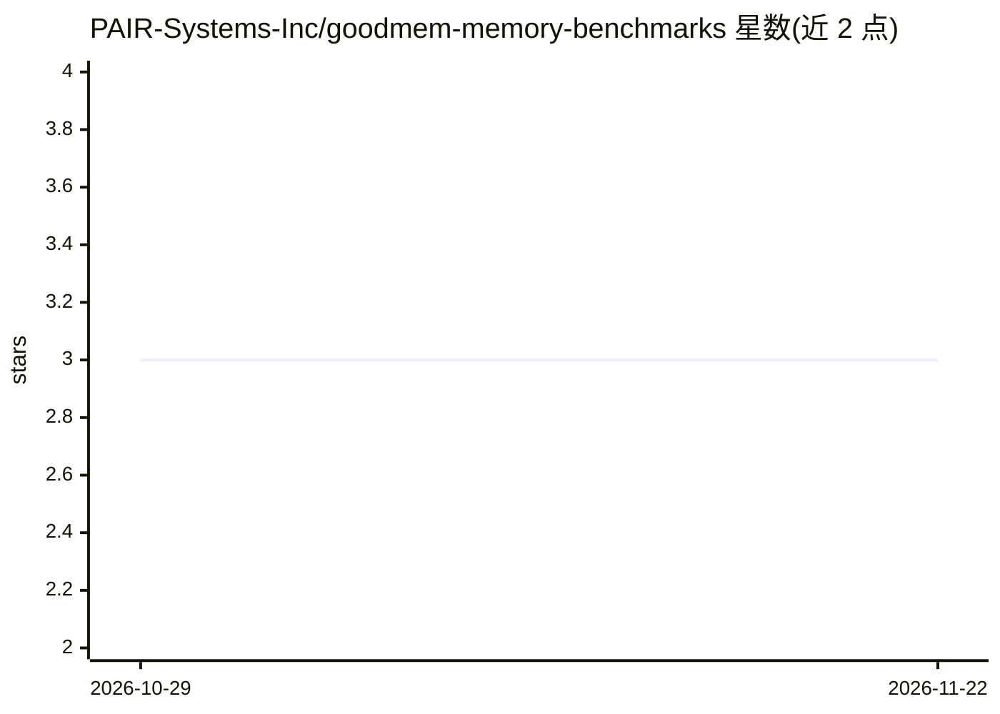

# PAIR-Systems-Inc/goodmem-memory-benchmarks

⭐ 3 · Python · MIT · 推送 2026-10-25 · [GitHub](https://github.com/PAIR-Systems-Inc/goodmem-memory-benchmarks) · [官网](https://goodmem.ai) · 组织维护

**用 GoodMem 复现 arXiv 论文记忆基准实验的评测工具**

以 GoodMem 为上下文层，复现论文《Is Complex Agentic Memory Always Needed?》在 LoCoMo、MemoryAgentBench、BEAM 三个基准上的实验。工作流分 ingest/retrieve/read/judge/export 五个阶段：把对话历史存入 GoodMem，检索原始片段供固定提示词的 reader 作答，再由 judge 模型打分并输出置信区间与证据覆盖检查。需要 Python 3.13、uv 和一个可访问的 GoodMem 实例，并注册 embedder、reranker、reader/judge 模型。MIT 许可。

## 筛选速览

| 维度 | 判定 | 备注 |
|---|---|---|
| AI 角色 | `ai-ecosystem` | LLM/agent 周边工具 |
| 许可风险 | `permissive` | MIT |
| 部署形态 | `library` | 以包/库形式分发 |
| 模型依赖 | — | README 未给出锁定关系 |
| 硬件要求 | — | 无带数字的原话,不猜 |
| 安装摩擦 | `low` | 无编译、无系统依赖或容器化 |
| 成熟度 | — | 结构信号不足 |

## 能力要点

- ingest→retrieve→read→judge→export 五阶段基准流水线（gmbench CLI）
- 证据覆盖检查与 drift 命令比对上下文变化
- 输出目录含摘要、回答、评分与检索索引等导出文件
- 基于 bootstrap 区间的可复现评分（summary.py 计算）

## 适用场景

- 复现并核验论文 RAW-RAG 与记忆系统对比的实验结果
- 以固定 reader/judge 协议评测不同 reranker 检索栈
- 测量对话记忆系统的顺序写入与索引耗时

## 场景标签

`模型评测` `RAG` `科研工具` · 领域:评测与运维

## 证据(README 行号)

> L3: Reproducing the experiments in [*Is Complex Agentic Memory Always Needed? Naive
> L8: repository uses GoodMem to store that history and supply the passages used to
> L67: You need Python 3.13, uv, and a reachable

## 星数曲线

2026-10-29 3 → 2026-11-22 3（+0）

---
*卡片 v1 · prompt 1.4 · 生成 2026-11-22 · 置信度 high · 依据 README sha `ef7c06857672` · [字段定义](../../DATASET.md)*
