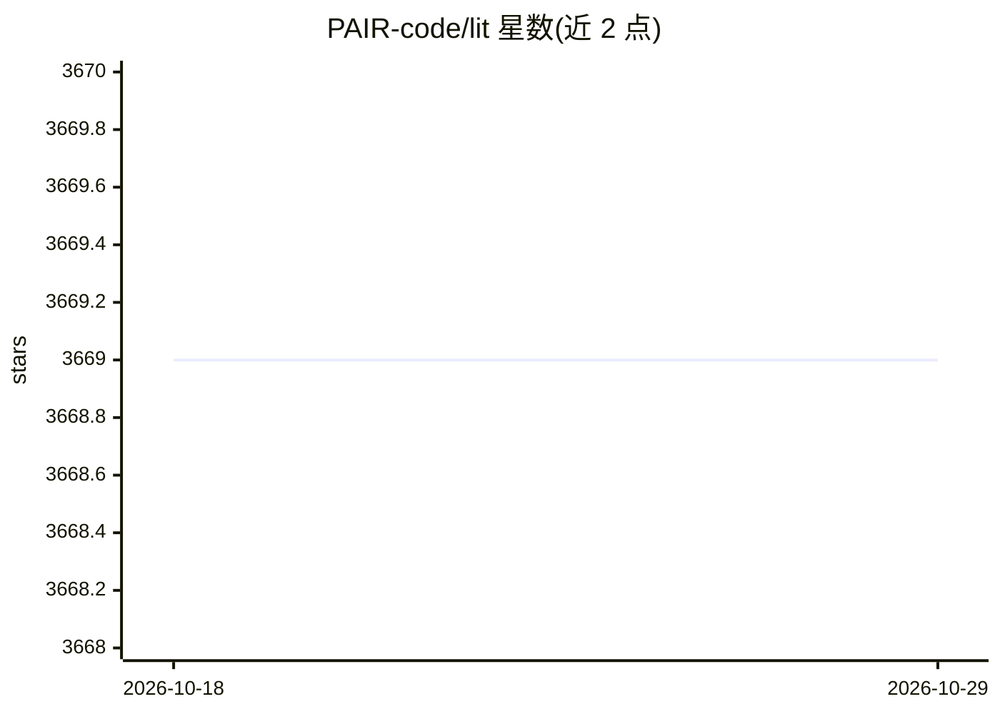

# PAIR-code/lit

⭐ 3,669 · TypeScript · Apache-2.0 · 推送 2026-10-07 · [GitHub](https://github.com/PAIR-code/lit) · [官网](https://pair-code.github.io/lit) · 组织维护

**可视化交互式 ML 模型理解与调试工具，支持文本/图像/表格数据**

LIT（Learning Interpretability Tool，前身为 Language Interpretability Tool）是面向模型理解的浏览器 UI 工具：通过显著图做局部解释、聚合指标与切片分箱、嵌入空间可视化、反事实生成，以及多模型或多输入并排对比；框架无关，兼容 TensorFlow、PyTorch。可作为独立服务器运行，也可嵌入 Colab/Jupyter/Vertex AI notebook。用户通过实现 Dataset/Model API 接入自己的模型；提供 pip 安装、源码构建（需 Python 3.9+ 与 yarn 构建前端）及容器镜像。

## 筛选速览

| 维度 | 判定 | 备注 |
|---|---|---|
| AI 角色 | `ai-ecosystem` | LLM/agent 周边工具 |
| 许可风险 | `permissive` | Apache-2.0 |
| 部署形态 | `library` | 以包/库形式分发 |
| 模型依赖 | — | README 未给出锁定关系 |
| 硬件要求 | — | 无带数字的原话,不猜 |
| 安装摩擦 | `low` | 无编译、无系统依赖或容器化 |
| 成熟度 | `idea` | |

## 能力要点

- 显著图局部解释与预测可视化
- 自定义指标、切片分箱、嵌入空间聚合分析
- 手动编辑或插件生成反事实样本并评估
- 并排模式对比多个模型或同一模型的多组输入

## 适用场景

- 调试分类/回归/seq2seq 模型，找出表现差的样本类型
- 分析预测归因，检查训练集先验带来的偏差
- 通过反事实编辑检验模型对文本风格、性别代词等变化的稳定性
- 在 Colab/Jupyter 内交互式分析自己的模型

## 场景标签

`模型评测` · 领域:评测与运维

## 证据(README 行号)

> L3: The Learning Interpretability Tool (🔥LIT, formerly known as the Language
> L4: Interpretability Tool) is a visual, interactive ML model-understanding tool that
> L19: LIT supports a variety of debugging workflows through a browser-based UI.

## 星数曲线

2026-10-18 3,669 → 2026-10-29 3,669（+0）

---
*卡片 v1 · prompt 1.4 · 生成 2026-10-20 · 置信度 high · 依据 README sha `0e258beb7e22` · [字段定义](../../DATASET.md)*
