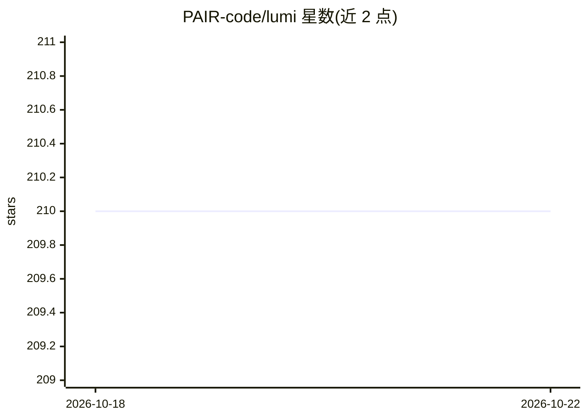

# PAIR-code/lumi

⭐ 210 · Python · Apache-2.0 · 推送 2026-09-16 · [GitHub](https://github.com/PAIR-code/lumi) · [官网](https://lumi.withgoogle.com) · 组织维护

**帮助读者快速阅读理解 arXiv 论文的 AI 辅助阅读应用**

Lumi 是一个基于 Web 的论文阅读应用：针对 arXiv 论文提供多粒度的 AI 摘要标注、文本高亮加提问、以及对论文插图的问答解释。面向需要快速理解研究论文的读者与科研人员，目前仅能处理采用 Creative Commons 许可的 arXiv 论文。架构上前端为 npm 管理的 Web 应用，后端使用 Firebase 云函数与本地模拟器，论文数据可经 Python 脚本本地导入调试，支持 App Engine 部署与 Storybook 组件展示。

## 筛选速览

| 维度 | 判定 | 备注 |
|---|---|---|
| AI 角色 | `ai-native` | 本体是模型或模型工具 |
| 许可风险 | `permissive` | Apache-2.0 |
| 部署形态 | `library` | 以包/库形式分发 |
| 模型依赖 | — | README 未给出锁定关系 |
| 硬件要求 | — | 无带数字的原话,不猜 |
| 安装摩擦 | `low` | 无编译、无系统依赖或容器化 |
| 成熟度 | — | 结构信号不足 |

## 能力要点

- AI 增强标注：多粒度阅读摘要
- 文本高亮并可对高亮内容提问
- 对论文插图提问并获得解释
- 提供本地论文导入脚本与 Storybook 调试

## 适用场景

- 快速浏览和理解 arXiv 论文内容
- 阅读时对高亮段落或插图直接提问
- 本地部署并导入自有论文进行调试

## 场景标签

`科研工具` `文档问答` · 领域:知识与检索

## 证据(README 行号)

> L3: Lumi uses AI to help you quickly read and understand arXiv papers. Features include:
> L5: - ✏️ **AI-augmented annotations** - read summaries at multiple granularities

## 星数曲线

2026-10-18 210 → 2026-10-22 210（+0）

---
*卡片 v1 · prompt 1.4 · 生成 2026-10-22 · 置信度 high · 依据 README sha `6ba4b84bfa3a` · [字段定义](../../DATASET.md)*
