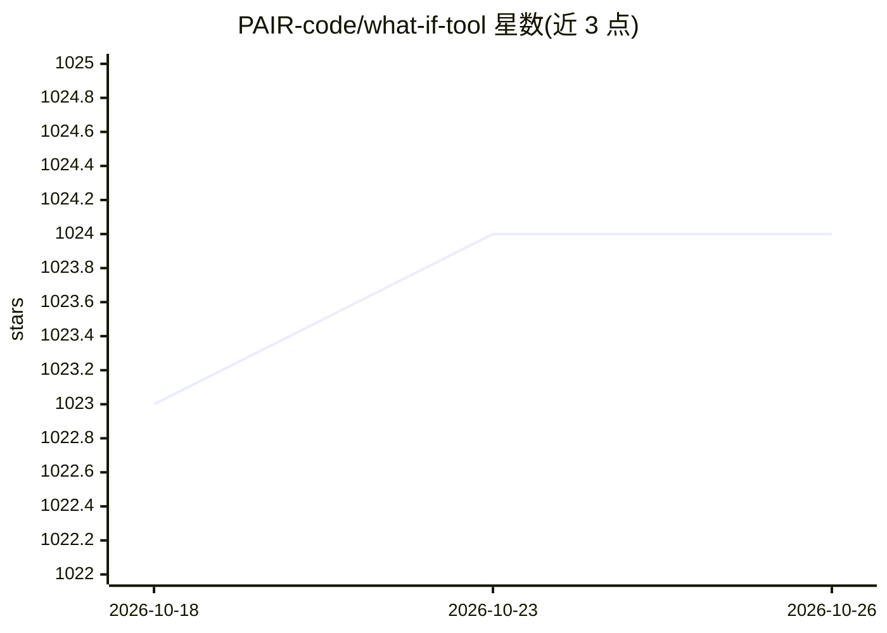

# PAIR-code/what-if-tool

⭐ 1,024 · HTML · Apache-2.0 · 推送 2026-09-21 · [GitHub](https://github.com/PAIR-code/what-if-tool) · [官网](https://pair-code.github.io/what-if-tool) · 组织维护

**黑盒 ML 模型的可视化理解与公平性分析工具**

Google PAIR 开发的 What-If Tool（WIT），为已训练的分类或回归模型提供无代码的可视化探查界面：对大量样本执行推理并多方式可视化结果，手动或程序化编辑样本后重跑观察结果变化，支持反事实样本比较、部分依赖图、归因值展示，以及在数据集子集上考察模型性能与公平性。可通过 TensorBoard 插件或 Jupyter/Colab 扩展使用；支持 TensorFlow Serving 托管模型、AI Platform Prediction 模型或自定义预测函数，也可直接加载 CSV 数据集。

## 筛选速览

| 维度 | 判定 | 备注 |
|---|---|---|
| AI 角色 | `ai-ecosystem` | LLM/agent 周边工具 |
| 许可风险 | `permissive` | Apache-2.0 |
| 部署形态 | `library` | 以包/库形式分发 |
| 模型依赖 | — | README 未给出锁定关系 |
| 硬件要求 | — | 无带数字的原话,不猜 |
| 安装摩擦 | `low` | 无编译、无系统依赖或容器化 |
| 成熟度 | — | 结构信号不足 |

## 能力要点

- 无代码可视化界面探查黑盒分类/回归模型
- 一键比较最相似的反事实样本（L1/L2 距离，可自定义距离函数）
- 在数据集子集上考察模型性能与公平性
- 支持编辑样本并重跑推理、部分依赖图与归因值展示

## 适用场景

- 训练完模型后在 Jupyter/Colab 或 TensorBoard 中检查预测结果
- 分析模型在不同数据子集上的性能与公平性
- 通过反事实样本理解模型决策依据

## 场景标签

`模型评测` · 领域:评测与运维

## 证据(README 行号)

> L5: The What-If Tool (WIT) provides an easy-to-use interface for expanding
> L6: understanding of a black-box classification or regression ML model.
> L11: It contains tooling for investigating model performance and fairness over

## 星数曲线

2026-10-18 1,023 → 2026-10-26 1,024（+1）

---
*卡片 v1 · prompt 1.4 · 生成 2026-10-21 · 置信度 high · 依据 README sha `3284ba560d8f` · [字段定义](../../DATASET.md)*
