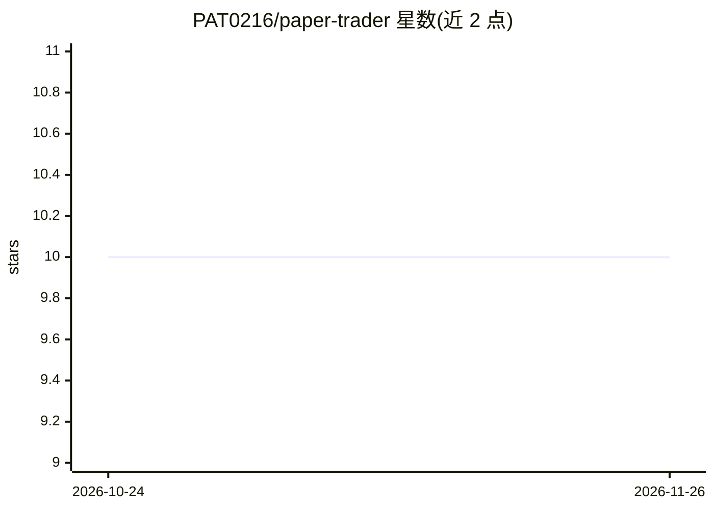

# PAT0216/paper-trader

⭐ 10 · Python · MIT · 推送 2026-11-25 · [GitHub](https://github.com/PAT0216/paper-trader) · [官网](https://paper-trader-ai.streamlit.app/) · 个人维护

**在标普 500 股票上并行运行三种策略并每日自动执行的模拟交易系统**

算法交易模拟（paper trading）系统：动量、XGBoost 集成、LSTM 三个策略并行运行并对比收益、夏普比率与最大回撤，含 SPY 基准与 5 个基点滑点的交易成本模型。数据来源 yfinance/FRED，缓存于 SQLite 与 S3；通过 AWS Lambda + EventBridge 定时执行交易，GitHub Actions 负责数据刷新、模型重训与 CI，Streamlit 提供实时仪表盘。声明仅用于教育目的的模拟交易，不可用于真实资金。

## 筛选速览

| 维度 | 判定 | 备注 |
|---|---|---|
| AI 角色 | `ai-native` | 本体是模型或模型工具 |
| 许可风险 | `permissive` | MIT |
| 部署形态 | `self-host` | docker 或自建部署 |
| 模型依赖 | — | README 未给出锁定关系 |
| 硬件要求 | — | 无带数字的原话,不猜 |
| 安装摩擦 | `low` | 无编译、无系统依赖或容器化 |
| 成熟度 | — | 结构信号不足 |

## 能力要点

- 三策略并行对比：12 个月动量、XGBoost 集成（15 个技术特征）、TensorFlow LSTM（60 天序列）
- AWS Lambda + EventBridge 定时无人值守执行，Git 账本记录全部交易
- 风险控制：单股 15%/行业 30% 仓位上限、15% 止损、回撤分级熔断
- Streamlit 仪表盘展示与 SPY 的对比与交易历史

## 适用场景

- 对比机器学习与因子动量策略在美股上的模拟表现
- 学习事件驱动定时执行与数据缓存的数据工程流程
- 用作量化策略的教学与回测参考

## 场景标签

`金融量化` · 领域:学习与行业

## 证据(README 行号)

> L19: |**ML**|XGBoost ensemble predictions|Daily (weekdays)|`data/ledgers/ledger_ml.csv`|
> L180: |**LSTM**|Deep Learning (60-day sequential patterns, TensorFlow)|Daily|

## 星数曲线

2026-10-24 10 → 2026-11-26 10（+0）

---
*卡片 v1 · prompt 1.4 · 生成 2026-11-20 · 置信度 high · 依据 README sha `7a4f342c6a4d` · [字段定义](../../DATASET.md)*
