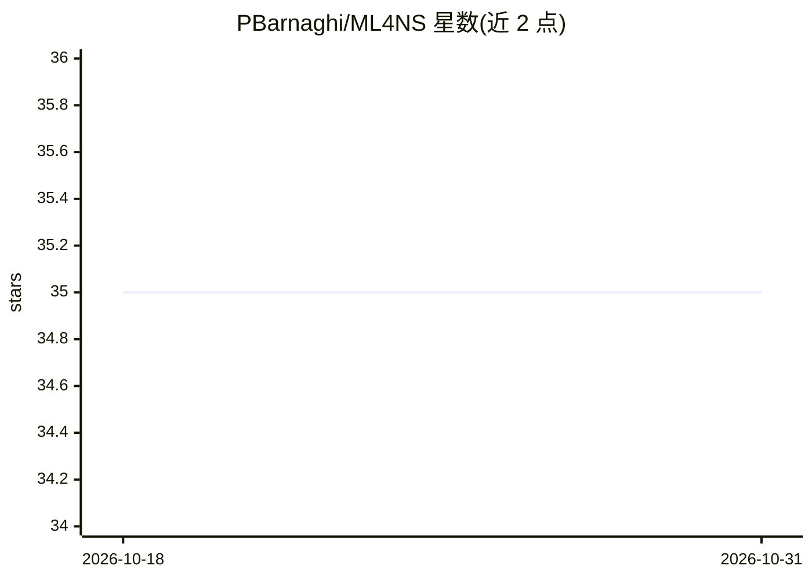

# PBarnaghi/ML4NS

⭐ 35 · Jupyter Notebook · 推送 2026-02-02 · [GitHub](https://github.com/PBarnaghi/ML4NS) · 组织维护

**帝国理工神经科学机器学习课程的讲义与实验笔记合集**

Imperial College London 脑科学系 2023 春季 Machine Learning for Neuroscience 课程仓库，面向转化神经科学方向研究生。内容含 11 个主题模块的讲义、幻灯片与 Jupyter 实验笔记，覆盖回归、贝叶斯模型、SVM、神经网络、CNN（含阿尔茨海默 MRI 数据集实验）等；附加生成式 AI 选讲（Transformers、GPT 示例、VAE、扩散模型）。笔记可在 Google Colab 与 Kaggle 打开运行，提供 environment.yml 建环境，内容 CC BY 4.0、软件部分 BSD-3 授权。

## 筛选速览

| 维度 | 判定 | 备注 |
|---|---|---|
| AI 角色 | `ai-knowledge` | 知识聚合/清单类 |
| 许可风险 | `none` | — |
| 部署形态 | `None` |  |
| 模型依赖 | — | README 未给出锁定关系 |
| 硬件要求 | — | 无带数字的原话,不猜 |
| 安装摩擦 | `low` | 无编译、无系统依赖或容器化 |
| 成熟度 | — | 结构信号不足 |

## 能力要点

- 11 个主题模块的讲义、幻灯片与实验笔记本
- CNN 实验使用阿尔茨海默病预处理 MRI 数据集
- 生成式 AI 选讲覆盖 Transformers/GPT、VAE、扩散模型及配套 Notebook
- 全部笔记本提供 Google Colab 与 Kaggle 在线运行入口

## 适用场景

- 系统学习面向神经科学的机器学习方法
- 在 Colab/Kaggle 上直接运行课程实验代码
- 了解机器学习在神经疾病数据上的应用案例

## 场景标签

`教程课程` · 领域:学习与行业

## 证据(README 行号)

> L1: # Machine Learning for Neuroscience
> L39: 1. Introduction to Machine Learning
> L101: This optional series focus on generative AI models and cover a range of recent models in this domain, including Tr

## 星数曲线

2026-10-18 35 → 2026-10-31 35（+0）

---
*卡片 v1 · prompt 1.4 · 生成 2026-10-25 · 置信度 high · 依据 README sha `db021d8813a4` · [字段定义](../../DATASET.md)*
