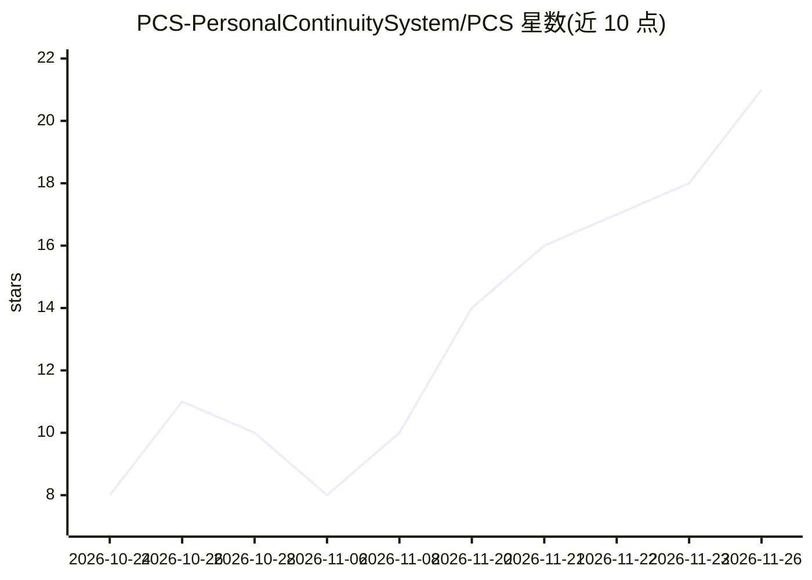

# PCS-PersonalContinuitySystem/PCS

⭐ 21 · GPL-3.0 · 推送 2026-11-20 · [GitHub](https://github.com/PCS-PersonalContinuitySystem/PCS) · [官网](https://pcs-personalcontinuitysystem.github.io/PCS-site/) · 个人维护

**个人拥有的 AI 连续性工作区：跨模型保留记忆与笔记**

PCS 是一款 Windows 桌面应用，把 AI 对话、可修订记忆、阅读材料、笔记与日历规划整合到一个用户本地拥有的工作区中。用户可在 Local、Google、OpenAI、Meta、Claude、ChatGPT 登录或 OpenRouter 等连接之间切换，已保存的对话、记忆与笔记本保留不变。关键机制包括加密的停止点架子、Continuity Map 主题关联图（本地计算不调用模型）、可检查和修订的记忆条目，以及记忆库口令保护。当前版本 0.9.180 仅提供 Windows x64 包，Linux 与 macOS 为较早的实验构建；本地模型、AI 运行时与语音包需另行下载。

## 筛选速览

| 维度 | 判定 | 备注 |
|---|---|---|
| AI 角色 | `ai-native` | 本体是模型或模型工具 |
| 许可风险 | `viral` | GPL-3.0 |
| 部署形态 | `desktop` | 安装包/桌面程序 |
| 模型依赖 | locked-api |  |
| 硬件要求 | — | 无带数字的原话,不猜 |
| 安装摩擦 | `medium` | 含编译或系统依赖之一 |
| 成熟度 | — | 结构信号不足 |

## 能力要点

- 切换 AI 连接时保留已保存的对话、记忆与笔记本
- Continuity Map 在本地 PC 上生成主题关联，最多读取 50,000 条记忆
- 记忆可检查、可修订、可删除，模型解释与原句保持区分
- 可选 Voice 语音与 OBS Screen 场景接入

## 适用场景

- 跨多次会话推进一个未完成的想法或问题
- 阅读、做笔记并让 AI 讨论读到的段落
- 在多个 AI 模型间切换而不丢失个人上下文

## 场景标签

`AI 助手` `知识库管理` · 领域:对话与助手

## 证据(README 行号)

> L5: Some thoughts need more than one conversation. PCS brings AI conversation, revisable memory, reading, notes and plan
> L7: **Change the AI. Keep your continuity.** Choose a supported Local, Google, OpenAI, Meta, Claude, signed-in ChatGPT o
> L35: Manual reading, notes, Calendar entries and saved-record browsing work without starting an AI conversation.

## 星数曲线

2026-10-24 8 → 2026-11-26 21（+13）

---
*卡片 v1 · prompt 1.4 · 生成 2026-11-20 · 置信度 high · 依据 README sha `1b56345775ef` · [字段定义](../../DATASET.md)*
