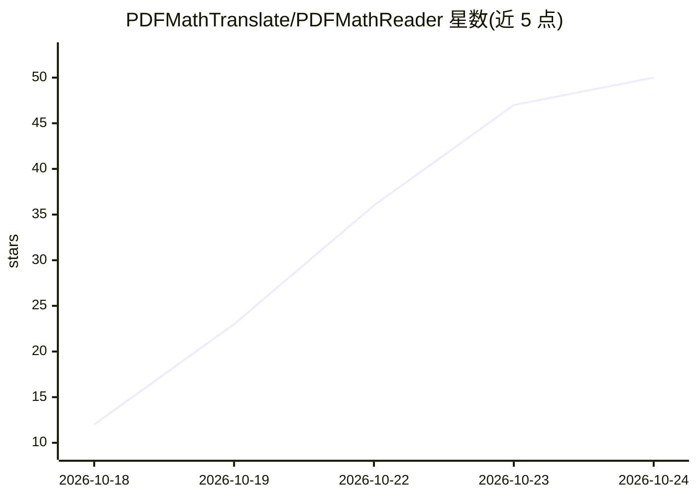

# PDFMathTranslate/PDFMathReader

⭐ 52 · JavaScript · AGPL-3.0 · 推送 2026-10-24 · [GitHub](https://github.com/PDFMathTranslate/PDFMathReader) · [官网](https://pdfmathtranslate.github.io/PDFMathReader/) · 组织维护 · 中文 README

**跨平台科学文献实时翻译阅读器，保留公式与排版**

基于 Electron/Vue/PDF.js 的桌面与 iOS 阅读应用，面向需要阅读外文科学文献的用户：边阅读边做版面检测与翻译，保留公式、表格等内容；支持接入主流 AI 提供商与 OpenAI 兼容自定义服务。提供 Ultra fast/Fast/Precise 三档翻译引擎（本地 PDF Inspector 与 PDFMathTranslate 内核，后者运行于 uv 管理的 Python 环境）。版面分析与 PDF 渲染本地执行，翻译会发送文档文本并可能产生 API 费用；不支持扫描件（无 OCR），macOS 为主要测试平台。

## 筛选速览

| 维度 | 判定 | 备注 |
|---|---|---|
| AI 角色 | `ai-native` | 本体是模型或模型工具 |
| 许可风险 | `viral` | AGPL-3.0 |
| 部署形态 | `desktop` | 安装包/桌面程序 |
| 模型依赖 | — | README 未给出锁定关系 |
| 硬件要求 | — | 无带数字的原话,不猜 |
| 安装摩擦 | `low` | 无编译、无系统依赖或容器化 |
| 成熟度 | — | 结构信号不足 |

## 能力要点

- 三档翻译引擎（Ultra fast/Fast/Precise），公式与排版保留程度不同
- 接入主流 AI 提供商或 OpenAI 兼容 API 做翻译
- 翻译结果跨文档与重启缓存，相同请求复用
- 标注、目录生成、TF-IDF 术语强调、仿生阅读等阅读辅助功能

## 适用场景

- 用母语阅读外文论文并保留公式排版
- 阅读时做高亮与批注，原文与译文对照
- 通过 OpenAI 兼容接口接入自选翻译服务

## 场景标签

`科研工具` · 领域:学习与行业

## 证据(README 行号)

> L13: Read scientific documents in your language, in realtime, on any platform.
> L23: - **Choose your preferred translation service**:
> L150: |Setting|Engine|Output|

## 星数曲线

2026-10-18 12 → 2026-10-24 50（+38）

---
*卡片 v1 · prompt 1.4 · 生成 2026-10-24 · 置信度 high · 依据 README sha `008d7c15fff3` · [字段定义](../../DATASET.md)*
