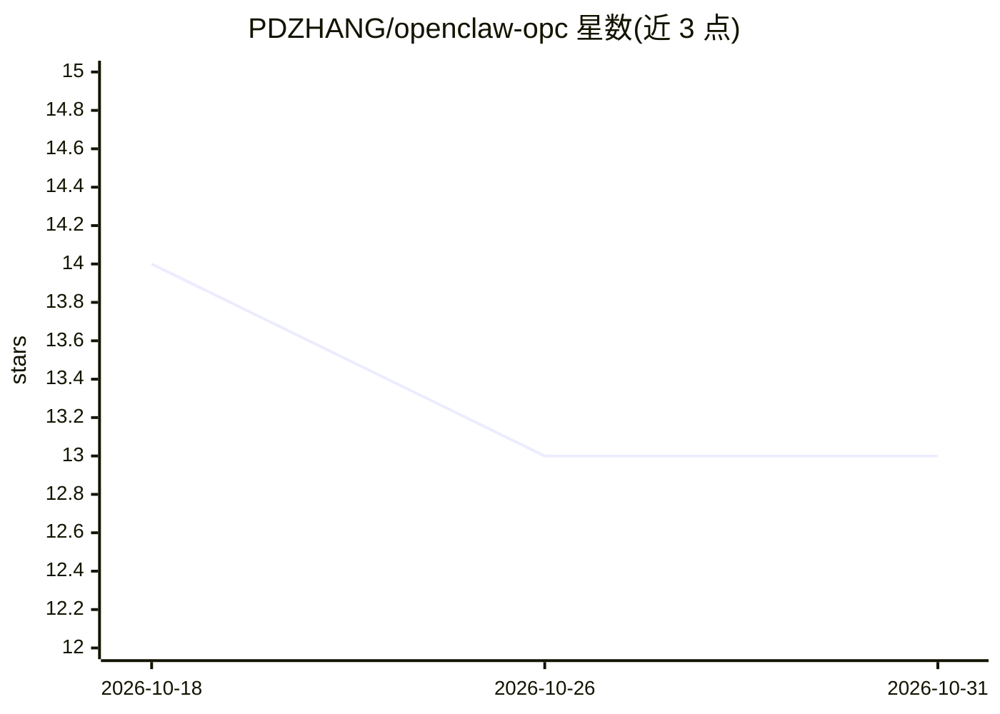

# PDZHANG/openclaw-opc

⭐ 13 · TypeScript · MIT · 推送 2026-03-30 · [GitHub](https://github.com/PDZHANG/openclaw-opc) · [官网](https://openclaw.ai) · 个人维护 · 中文 README

**多智能体协作平台：创建和管理 AI 员工团队协同工作**

基于 OpenClaw 框架构建的多智能体协作平台，提供 AI 员工的创建、编辑与角色模板配置（含 SOUL.md 个性编辑器）、单聊/群聊与@提及的聊天功能、自动任务分配与协作链可视化、实时状态监控看板，以及阿里云、Dify、自定义多知识库接入。后端为 Node.js + TypeScript + Express + SQL.js，前端 React 18 + Vite，支持本地 npm 开发与 Docker Compose 部署。面向需要搭建人机协作 AI 团队的开发者与小型团队。

## 筛选速览

| 维度 | 判定 | 备注 |
|---|---|---|
| AI 角色 | `ai-ecosystem` | LLM/agent 周边工具 |
| 许可风险 | `permissive` | MIT |
| 部署形态 | `self-host` | docker 或自建部署 |
| 模型依赖 | — | README 未给出锁定关系 |
| 硬件要求 | — | 无带数字的原话,不猜 |
| 安装摩擦 | `low` | 无编译、无系统依赖或容器化 |
| 成熟度 | — | 结构信号不足 |

## 能力要点

- AI 员工管理：SOUL.md 编辑器与预设角色模板
- 智能消息解析与任务自动分配、协作链可视化
- 多知识库接入（阿里云、Dify、自定义）并绑定 AI 员工
- 提供 Docker Compose 容器化部署

## 适用场景

- 搭建一人公司式的 AI 员工团队协同处理任务
- 通过聊天 IM 界面与多个 AI 员工协作并追踪其状态
- 将 AI 员工接入企业知识库做检索问答

## 场景标签

`多智能体` `AI 助手` `RAG` · 领域:Agent 开发

## 证据(README 行号)

> L15: **OpenClaw OPC** (OpenClaw Orchestration & Collaboration Platform) 是一个强大的多智能体协作平台，基于 OpenClaw 框架构建，让你可以轻松创建、管理和协调一个
> L20: - 🧠 **智能协作引擎** - AI 员工可以自主识别协作需求，自动分配任务

## 星数曲线

2026-10-18 14 → 2026-10-31 13（-1）

---
*卡片 v1 · prompt 1.4 · 生成 2026-10-31 · 置信度 high · 依据 README sha `d567f7fcab07` · [字段定义](../../DATASET.md)*
