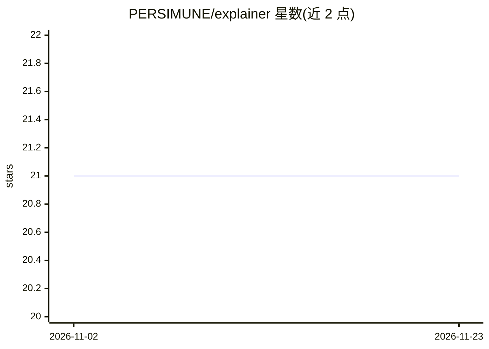

# PERSIMUNE/explainer

⭐ 21 · HTML · NOASSERTION · 推送 2026-11-07 · [GitHub](https://github.com/PERSIMUNE/explainer) · [官网](https://persimune.github.io/explainer/) · 个人维护

**R 包：用 SHAP 解释分类与回归模型并交互可视化**

面向 R 用户的模型可解释性包，基于 SHAP（Shapley additive explanations）解释分类与回归模型：查看各特征对单条预测的贡献、探索相似解释的子群、评估模型表现。提供 eSHAP_plot 交互式 SHAP 图与多分类支持（eSHAP_plot_multiclass），教程示例基于 mlr3 训练的模型。安装途径为 CRAN 发布版与 GitHub 开发版，另有 Kaggle 在线示例与 Hugging Face Space 展示。由 PERSIMUNE（丹麦）的 Ramtin Zargari Marandi 开发，配套论文发表于 Bioinformatics Advances，Google Scholar 显示被 14 篇论文引用。

## 筛选速览

| 维度 | 判定 | 备注 |
|---|---|---|
| AI 角色 | `ai-ecosystem` | LLM/agent 周边工具 |
| 许可风险 | `none` | NOASSERTION |
| 部署形态 | `None` |  |
| 模型依赖 | — | README 未给出锁定关系 |
| 硬件要求 | — | 无带数字的原话,不猜 |
| 安装摩擦 | `low` | 无编译、无系统依赖或容器化 |
| 成熟度 | — | 结构信号不足 |

## 能力要点

- 基于 SHAP 计算特征对个体预测的贡献
- eSHAP_plot 交互式 SHAP 可视化与多分类函数
- 覆盖二分类、多分类、回归三类教程
- 配套 Kaggle 可运行示例与 Hugging Face 交互展示

## 适用场景

- 解释我训练的临床/科研分类模型的预测依据
- 按 SHAP 解释聚类探索特征贡献相似的样本子群
- 在浏览器中交互查看 SHAP 图而无需本地运行代码

## 场景标签

 · 领域:机器学习可解释性/生物医学研究

## 证据(README 行号)

> L5: ExplaineR is an open-source R package for explaining classification and regression models with SHAP (Shapley additiv
> L87: Zargari Marandi, Ramtin. "ExplaineR: an R package to explain machine learning models." Bioinformatics Advances 4, n

## 星数曲线

2026-11-02 21 → 2026-11-23 21（+0）

---
*卡片 v1 · prompt 1.4 · 生成 2026-11-18 · 置信度 high · 依据 README sha `e7f15346866d` · [字段定义](../../DATASET.md)*
