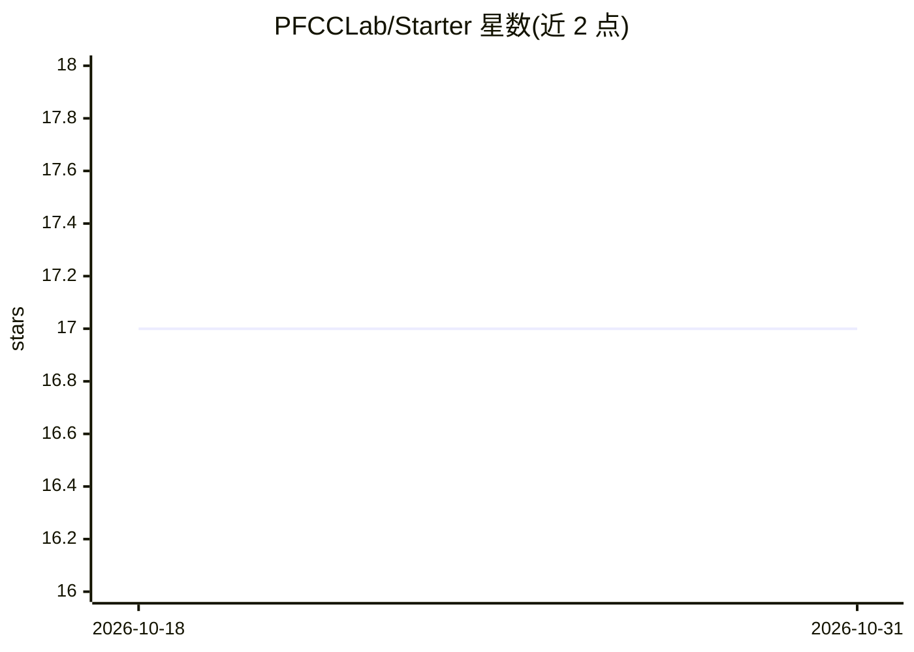

# PFCCLab/Starter

⭐ 17 · 推送 2026-03-10 · [GitHub](https://github.com/PFCCLab/Starter) · 组织维护 · 中文 README

**飞桨启航计划集训营的周报与资料管理仓库**

百度飞桨社区「启航计划」集训营的配套仓库：学员在此提交双周周报、过程文档、课程纪要与设计文档，按 Docs/、Meeting/、Reports/ 三个目录组织。集训为期 2 个月，目标是完成快乐开源任务、合入 1 个 PR 即可结营，期间提供课程辅导、研发支持与线上 V100 开发环境（AI Studio）。不限定开发者背景，企业与学生均可申请，通过简历筛选参与，结营可获奖励与证书，并有机会进入「护航计划」。

## 筛选速览

| 维度 | 判定 | 备注 |
|---|---|---|
| AI 角色 | `ai-knowledge` | 知识聚合/清单类 |
| 许可风险 | `none` | — |
| 部署形态 | `None` |  |
| 模型依赖 | — | README 未给出锁定关系 |
| 硬件要求 | — | 无带数字的原话,不猜 |
| 安装摩擦 | `low` | 无编译、无系统依赖或容器化 |
| 成熟度 | — | 结构信号不足 |

## 能力要点

- 学员双周周报与过程文档的统一存放管理
- Docs/Meeting/Reports 三目录组织课程与项目资料
- 为期 2 个月的远程集训，合入 1 个 PR 即满足结营条件
- 提供线上 V100 开发环境与集训课程辅导

## 适用场景

- 集训营学员提交双周周报与项目过程文档
- 查阅往期课程纪要、答疑记录与代码串讲材料
- 了解启航计划与护航计划的参与方式和区别

## 场景标签

 · 领域:开源社区/深度学习教育活动

## 证据(README 行号)

> L1: # 飞桨启航计划集训营周报 & 资料管理
> L5: - 本 repo 用于「飞桨启航计划集训营」的学员双周周报提交、资料管理、课程记录保存和技术方案探讨。希望这个 repo 能够记录下你在克服各种难题时的成长历程，以及你不断进步的足迹。享受这个过程吧！
> L18: **「启航计划」** 是 **百度飞桨社区** 发起的远程项目，也是「护航计划」的前置活动（不了解护航计划请看这里 ➡️ 护航计划说明）。我们以开展**集训营**的形式，鼓励开发者积极参与开源项目，以此提升自己的代码实践能力，与社

## 星数曲线

2026-10-18 17 → 2026-10-31 17（+0）

---
*卡片 v1 · prompt 1.4 · 生成 2026-10-30 · 置信度 high · 依据 README sha `99726b425fbf` · [字段定义](../../DATASET.md)*
