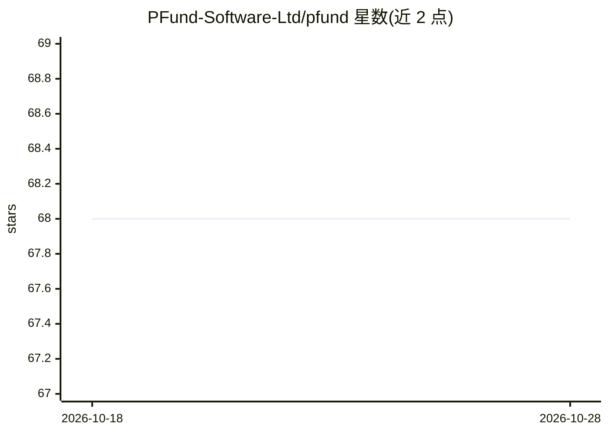

# PFund-Software-Ltd/pfund

⭐ 68 · Python · Apache-2.0 · 推送 2026-10-25 · [GitHub](https://github.com/PFund-Software-Ltd/pfund) · [官网](https://pfund.ai) · 组织维护

**面向散户的 Python 算法交易框架：回测/训练/实盘/监控一体化**

开源 Python 算法交易框架，覆盖向量化与事件驱动回测、超参数调优、模拟与实盘交易流程，支持传统金融（Interactive Brokers、Alpaca、Futu）、CeFi（Binance、Bybit、OKX）与 DeFi（dYdX）交易场所，多数对接仍在开发或待办状态。原生支持机器学习模型与特征，ML 框架无关，提供 LEGO 式策略/模型组合，回测切换实盘仅需改一行代码。README 声明库尚未就绪，需等待 0.1.0 版本发布；数据工作由配套库 PFeed 处理。

## 筛选速览

| 维度 | 判定 | 备注 |
|---|---|---|
| AI 角色 | `ai-ecosystem` | LLM/agent 周边工具 |
| 许可风险 | `permissive` | Apache-2.0 |
| 部署形态 | `library` | 以包/库形式分发 |
| 模型依赖 | — | README 未给出锁定关系 |
| 硬件要求 | — | 无带数字的原话,不猜 |
| 安装摩擦 | `low` | 无编译、无系统依赖或容器化 |
| 成熟度 | `idea` | |

## 能力要点

- 向量化与事件驱动回测，支持 tick/秒/分钟等多分辨率数据
- ML 框架无关的模型训练与 LEGO 式策略/模型组合
- 回测切换实盘仅需修改一行代码
- 支持 TradFi/CeFi/DeFi 多交易场所（多数为待办状态）

## 适用场景

- 我在统一框架里完成策略从回测到实盘部署的流程
- 我用机器学习模型驱动交易策略并做超参数调优
- 我在股票与加密货币市场复用同一套策略代码

## 场景标签

`金融量化` · 领域:学习与行业

## 证据(README 行号)

> L22:  pfund is an open-source Python algorithmic trading framework
> L38: - [x] Supports machine learning models, features, technical analysis indicators

## 星数曲线

2026-10-18 68 → 2026-10-28 68（+0）

---
*卡片 v1 · prompt 1.4 · 生成 2026-10-24 · 置信度 high · 依据 README sha `47ae56bcb7db` · [字段定义](../../DATASET.md)*
