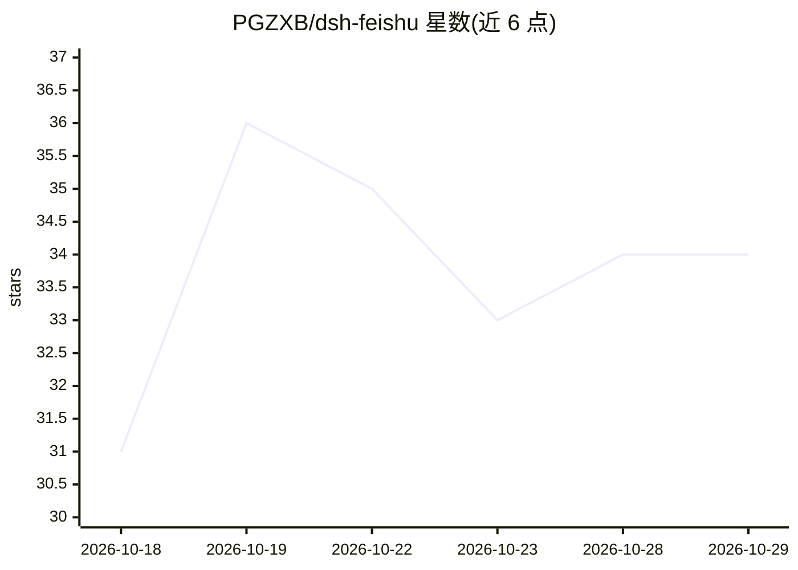

# PGZXB/dsh-feishu

⭐ 34 · TypeScript · MIT · 推送 2026-10-24 · [GitHub](https://github.com/PGZXB/dsh-feishu) · 个人维护 · 中文 README

**DeepSeek Harness 的飞书 UI 插件：卡片按钮控制 agent**

作为 DeepSeek Harness（dsh）的原生插件，把 agent 会话接入飞书聊天：每个斜杠命令渲染为控制面板卡片按钮，权限升级在卡内一键批准，agent 输出（工具调用、推理、markdown、表格）以流式卡片实时呈现，扫码即完成飞书应用配置。支持会话跨重启持久化、双向往返传文件、消息队列与转向、群组 @ 提及。需 Node.js ≥ 22.13，经 npm 或源码安装；README 注明宿主 dsh 尚处 pre-release，版本间可能破坏兼容。

## 筛选速览

| 维度 | 判定 | 备注 |
|---|---|---|
| AI 角色 | `ai-ecosystem` | LLM/agent 周边工具 |
| 许可风险 | `permissive` | MIT |
| 部署形态 | `library` | 以包/库形式分发 |
| 模型依赖 | locked-api |  |
| 硬件要求 | — | 无带数字的原话,不猜 |
| 安装摩擦 | `low` | 无编译、无系统依赖或容器化 |
| 成熟度 | `idea` | |

## 能力要点

- 控制面板卡片把全部命令渲染为按钮，卡内审批与提问
- 流式卡片实时展示工具调用、推理与最终回答
- 一次扫码完成飞书应用创建与 dsh profile 配置
- 会话与工作目录跨 daemon 重启持久化

## 适用场景

- 在飞书里通过卡片按钮驱动 DeepSeek Harness agent 工作
- 团队在飞书群 @ 机器人协作编码任务并在卡内审批
- 手机扫码零配置快速启用飞书 bot

## 场景标签

`编码 Agent` `聊天机器人` · 领域:编码与开发

## 证据(README 行号)

> L10: The Feishu UI for DeepSeek Harness (dsh) — a dsh-native plugin with a **panel-driven control console**: every slash
> L59: A Feishu chat is a dsh session — the bot is the agent's avatar. A typical
> L157: - **DeepSeek Harness** —

## 星数曲线

2026-10-18 31 → 2026-10-29 34（+3）

---
*卡片 v1 · prompt 1.4 · 生成 2026-10-25 · 置信度 high · 依据 README sha `e556b7e7b550` · [字段定义](../../DATASET.md)*
