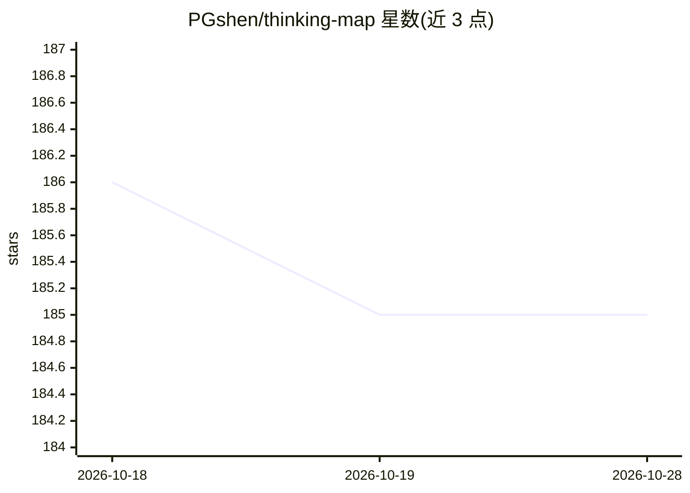

# PGshen/thinking-map

⭐ 185 · Go · Apache-2.0 · 推送 2026-08-23 · [GitHub](https://github.com/PGshen/thinking-map) · [官网](https://thinking.zero-zero.cc) · 个人维护 · 中文 README

**把 AI 思考过程转为可视化思维导图、可随时干预的问题解决助手**

交互式 AI 问题解决可视化应用：将 AI 的思考与问题解决过程转化为图结构的思维导图，用户可在过程中干预、提问与调整。前端 Next.js 15 + ReactFlow，后端 Go（Gin、eino 多代理架构、SSE 流式），数据用 PostgreSQL 与 Redis。面向研究人员、学生、内容创作者与决策者等终端用户，需自行配置 AI 服务密钥（如 OPENAI/DeepSeek/Claude）。提供 Docker Compose 与源码两种启动方式。

## 筛选速览

| 维度 | 判定 | 备注 |
|---|---|---|
| AI 角色 | `ai-native` | 本体是模型或模型工具 |
| 许可风险 | `permissive` | Apache-2.0 |
| 部署形态 | `self-host` | docker 或自建部署 |
| 模型依赖 | — | README 未给出锁定关系 |
| 硬件要求 | — | 无带数字的原话,不猜 |
| 安装摩擦 | `low` | 无编译、无系统依赖或容器化 |
| 成熟度 | — | 结构信号不足 |

## 能力要点

- 将 AI 思考过程转化为可视化图结构，支持过程中干预与提问
- 后端基于 eino 的多代理架构与 SSE 流式输出
- 提供 Docker Compose 一键启动与源码运行两种方式

## 适用场景

- 结构化拆解复杂问题并可视化探索方案
- 查看并随时介入 AI 的多步思考过程
- 研究、写作与决策场景中梳理与记录思路

## 场景标签

`AI 助手` `知识库管理` · 领域:对话与助手

## 证据(README 行号)

> L8: - 产品定义：ThinkingMap 是一款交互式 AI 问题解决可视化助手，将 AI 的思考和问题解决过程转化为可视化的图结构，允许用户在过程中随时干预、提问。
> L10: - 目标用户：研究人员和学者、学生和教育工作者、内容创作者和写作者、分析师和决策者、产品和项目管理人员。

## 星数曲线

2026-10-18 186 → 2026-10-28 185（-1）

---
*卡片 v1 · prompt 1.4 · 生成 2026-10-22 · 置信度 mid · 依据 README sha `b9b133d67fb4` · [字段定义](../../DATASET.md)*
