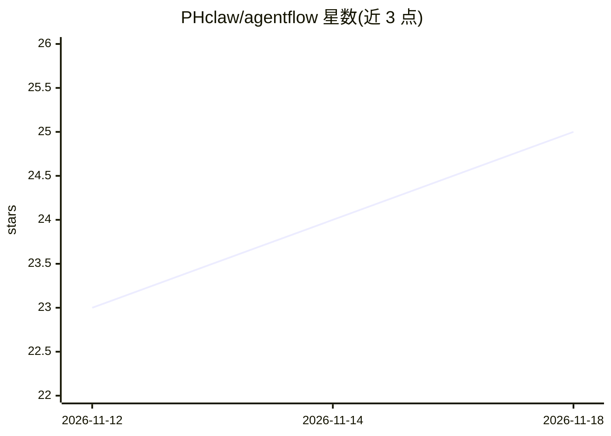

# PHclaw/agentflow

⭐ 25 · Python · Apache-2.0 · 推送 2026-11-17 · [GitHub](https://github.com/PHclaw/agentflow) · [官网](http://159.75.21.251:3000) · 个人维护 · 中文 README

**自托管零代码 AI Agent 平台：拖拽工作流+RAG+技能广场**

自托管的开源零代码 AI Agent 平台：提供 ReactFlow 拖拽式工作流编辑器（触发器/LLM/知识库/工具/条件分支/回复六类节点）、知识库 RAG（向量模型与对话模型分开配置）、26 个内置技能、模板市场与用户体系。支持任意 OpenAI 兼容端点（含本地 Ollama），界面内多模型热切换。默认 SQLite 单机运行，一条 docker compose 部署；官方 Docker 镜像未装 sentence-transformers，知识库检索需配置外部 EMBEDDING_BASE_URL。面向无开发团队的企业、产品经理与开发者。

## 筛选速览

| 维度 | 判定 | 备注 |
|---|---|---|
| AI 角色 | `ai-ecosystem` | LLM/agent 周边工具 |
| 许可风险 | `permissive` | Apache-2.0 |
| 部署形态 | `self-host` | docker 或自建部署 |
| 模型依赖 | local-ok | 支持本地模型 |
| 硬件要求 | — | 无带数字的原话,不猜 |
| 安装摩擦 | `low` | 无编译、无系统依赖或容器化 |
| 成熟度 | — | 结构信号不足 |

## 能力要点

- 拖拽式工作流编辑器，六类节点组合，改完即生效
- 26 个内置技能（Excel/PDF/PPT/学术检索等），SKILL.md 目录形式扩展
- 支持任意 OpenAI 兼容端点含本地 Ollama，多模型热切换无需重启
- 默认 SQLite 单机可跑，docker compose 一键私有化部署

## 适用场景

- 没有开发团队的企业搭建 AI 客服/销售助手
- 产品经理快速验证 Agent 场景
- 开发者用低代码方式编排 LLM 工作流并自托管数据

## 场景标签

`工作流自动化` `RAG` `Agent 框架` · 领域:Agent 开发

## 证据(README 行号)

> L18: 开源零代码 AI Agent 平台：拖拽式工作流编辑器 + 多模型热切换 + 知识库 RAG + Skill 广场 + 一键部署。
> L114: - **🤖 多模型热切换** — 在「设置 → 模型配置」里填端点与模型名即可，支持任意 **OpenAI 兼容**端点（含本地 Ollama），**改完不用重启**
> L121: **适合谁用**：想搭 AI 客服 / 销售助手但没有开发团队的企业；需要快速验证 Agent 场景的产品经理；想用低代码编排 LLM 工作流的开发者。

## 星数曲线

2026-11-12 23 → 2026-11-18 25（+2）

---
*卡片 v1 · prompt 1.4 · 生成 2026-11-18 · 置信度 mid · 依据 README sha `c4710603be3a` · [字段定义](../../DATASET.md)*
