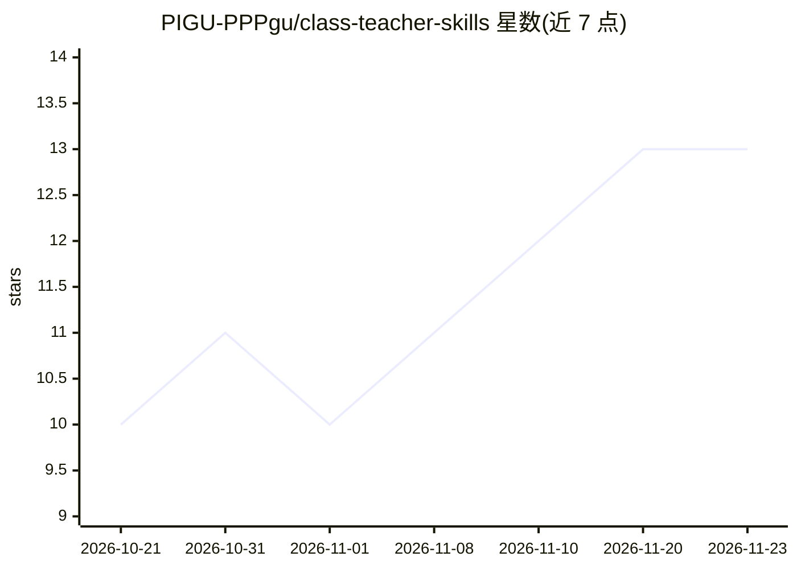

# PIGU-PPPgu/class-teacher-skills

⭐ 13 · Python · MIT · 推送 2026-07-27 · [GitHub](https://github.com/PIGU-PPPgu/class-teacher-skills) · 个人维护 · 中文 README

**给班主任的 AI 技能仓库：43 个班务场景模板与脚本**

以标准 Agent Skill（SKILL.md + frontmatter）组织的班主任工作技能仓库，覆盖 43 个场景：家长通知与评语生成、谈话/违纪/家访记录、成绩与考勤分析、日报周报月报、座位分组值日编排、积分管理等。可作为 Skill 装入支持该机制的 Agent，也可当模板包直接复制改写，或用 Python 脚本跑成绩分析等任务；文档建议接入消息平台时保留人工确认环节，data/ 目录不入库以保护学生隐私。

## 筛选速览

| 维度 | 判定 | 备注 |
|---|---|---|
| AI 角色 | `ai-knowledge` | 知识聚合/清单类 |
| 许可风险 | `permissive` | MIT |
| 部署形态 | `library` | 以包/库形式分发 |
| 模型依赖 | — | README 未给出锁定关系 |
| 硬件要求 | — | 无带数字的原话,不猜 |
| 安装摩擦 | `low` | 无编译、无系统依赖或容器化 |
| 成熟度 | — | 结构信号不足 |

## 能力要点

- 43 个班务场景，目录结构与输入输出示例统一
- 根目录即标准 Skill，可被 Claude Code/Kimi 等直接加载
- 附 Python 脚本（如成绩分析）与模板库、范例库
- 隐私边界：真实学生数据不入库，.gitignore 排除 data/

## 适用场景

- 让 AI 帮我写家长群通知、期末评语、班级周报
- 把月考成绩整理成重点学生分析
- 新班级一键生成座位表、分组、值日表
- 维护家校沟通台账和违纪/谈话记录

## 场景标签

`AI 写作` `数据分析` `提示工程` · 领域:Agent 开发

## 证据(README 行号)

> L3: > 43 个场景 · 班主任 AI 工作台 · 可直接作为 Agent Skill 安装
> L5: 给班主任用的 AI 技能仓库。不是泛教育 prompt 集，是围绕真实班务拆出来的可复用工作台。
> L7: **本仓库根目录本身就是一个标准 Skill（`class-assistant`）**：根目录的 `SKILL.md` 带标准 frontmatter，任何支持 Skill 机制的 Agent（Claude Code、Kimi、He

## 星数曲线

2026-10-21 10 → 2026-11-23 13（+3）

---
*卡片 v1 · prompt 1.4 · 生成 2026-11-18 · 置信度 mid · 依据 README sha `c70140ede47e` · [字段定义](../../DATASET.md)*
