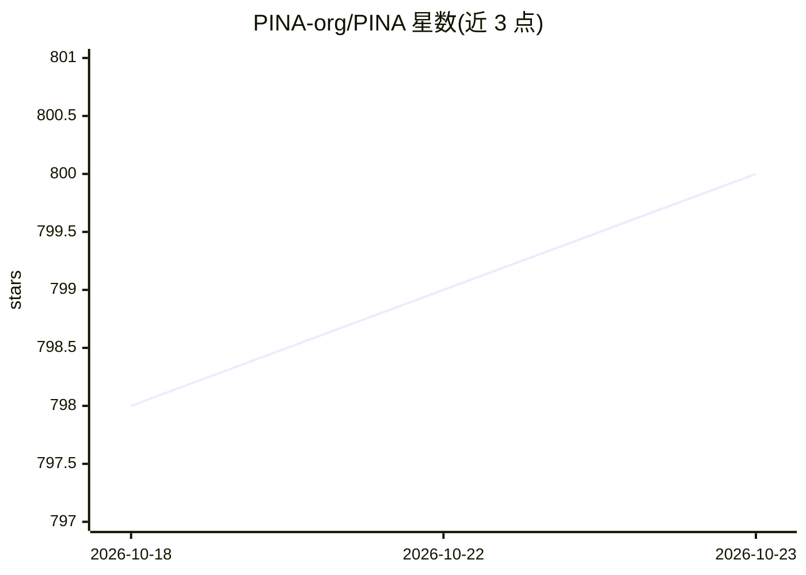

# PINA-org/PINA

⭐ 800 · Python · MIT · 推送 2026-10-21 · [GitHub](https://github.com/PINA-org/PINA) · [官网](https://pina-org.github.io/PINA/) · 组织维护

**科学机器学习 Python 库：用 PINN 与神经算子求解微分方程**

PINA 是基于 PyTorch、PyTorch Lightning 与 PyTorch Geometric 的开源 Python 库，面向科学机器学习（SciML）问题：物理信息神经网络（PINN）、神经算子、KAN、数据驱动建模与微分方程求解。采用 Problem/Model/Solver/Trainer 四步流水线，条件与求解器解耦，支持多设备训练与时间序列/图结构条件。v0.3.2 起附带面向 opencode、Claude Code、Cursor 的 AI agent 技能，引导用户完成从问题定义到训练的全流程。以 PyPI 包与源码两种方式安装，附教程与 JOSS 论文。

## 筛选速览

| 维度 | 判定 | 备注 |
|---|---|---|
| AI 角色 | `ai-native` | 本体是模型或模型工具 |
| 许可风险 | `permissive` | MIT |
| 部署形态 | `desktop` | 安装包/桌面程序 |
| 模型依赖 | — | README 未给出锁定关系 |
| 硬件要求 | — | 无带数字的原话,不猜 |
| 安装摩擦 | `low` | 无编译、无系统依赖或容器化 |
| 成熟度 | — | 结构信号不足 |

## 能力要点

- PINN、神经算子、KAN 与数据驱动建模统一框架
- Problem/Model/Solver/Trainer 四步流水线，条件与求解器解耦
- 自回归求解器与多模型求解器、时间序列与图时间序列条件
- v0.3.2 内置 AI agent 技能（opencode/Claude Code/Cursor）引导工作流

## 适用场景

- 用 PINN 求解 ODE/PDE 微分方程问题
- 在物理约束下做数据驱动建模与时间序列预测
- 借助 agent 技能以自然语言对话走完建模流程

## 场景标签

 · 领域:科学计算/机器学习

## 证据(README 行号)

> L18:  PINA is an open-source Python library designed to simplify and accelerate the development of
> L19:  Scientific Machine Learning (SciML) solutions, including PINNs, Neural Operators,
> L57: PINA provides an intuitive framework for defining, experimenting with, and solving complex problems using Neural Ne

## 星数曲线

2026-10-18 798 → 2026-10-23 800（+2）

---
*卡片 v1 · prompt 1.4 · 生成 2026-10-21 · 置信度 high · 依据 README sha `66bd3b2c82a0` · [字段定义](../../DATASET.md)*
