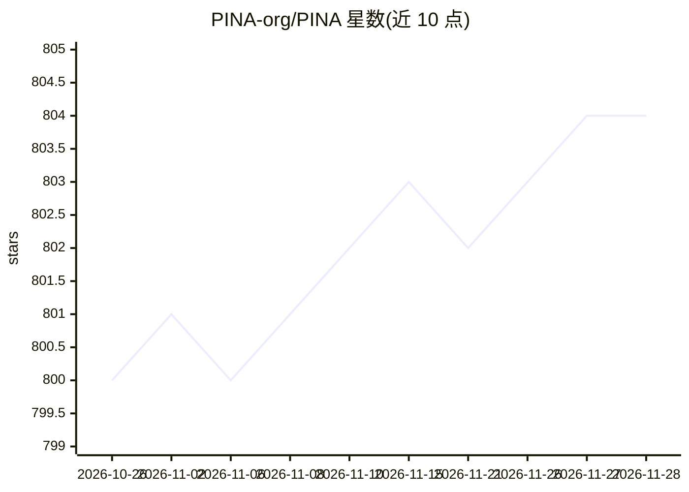

# PINA-org/PINA

⭐ 804 · Python · MIT · 推送 2026-11-24 · [GitHub](https://github.com/PINA-org/PINA) · [官网](https://pina-org.github.io/PINA/) · 组织维护

**面向科研人员的科学机器学习 Python 库：解微分方程与物理建模**

PINA 是一个开源 Python 库，用于简化科学机器学习（SciML）方案的开发，覆盖物理信息神经网络（PINNs）、神经算子、数据驱动建模等。基于 PyTorch、PyTorch Lightning 与 PyTorch Geometric 构建，提供四步流水线：Problem API 定义问题、Model API 设计模型、Solver API 选择求解器、Trainer API 训练。支持多设备训练与可组合的 mixin 架构，v0.3.2 加入引导用户的 AI agent 技能。开发受 SISSA MathLab 等科研机构资助。

## 筛选速览

| 维度 | 判定 | 备注 |
|---|---|---|
| AI 角色 | `ai-ecosystem` | LLM/agent 周边工具 |
| 许可风险 | `permissive` | MIT |
| 部署形态 | `desktop` | 安装包/桌面程序 |
| 模型依赖 | — | README 未给出锁定关系 |
| 硬件要求 | — | 无带数字的原话,不猜 |
| 安装摩擦 | `low` | 无编译、无系统依赖或容器化 |
| 成熟度 | — | 结构信号不足 |

## 能力要点

- PINNs、神经算子与数据驱动建模的统一框架
- 四步流水线：Problem/Model/Solver/Trainer API
- 原生多设备训练与可组合 mixin 架构
- 内置 AI agent 技能（opencode/Claude Code/Cursor）引导完整工作流

## 适用场景

- 求解 PDE/ODE 微分方程问题
- 做物理信息神经网络与神经算子实验
- 时间序列与图结构数据的自回归预测建模

## 场景标签

`科研工具` · 领域:学习与行业

## 证据(README 行号)

> L18:  PINA is an open-source Python library designed to simplify and accelerate the development of
> L113: Solving a differential problem in PINA follows a clean four-step pipeline:
> L179: This repository includes AI agent skills (guides for opencode, Claude Code, Cursor)

## 星数曲线

2026-10-26 800 → 2026-11-28 804（+4）

---
*卡片 v1 · prompt 1.4 · 生成 2026-11-24 · 置信度 high · 依据 README sha `30def2b3fa1f` · [字段定义](../../DATASET.md)*
