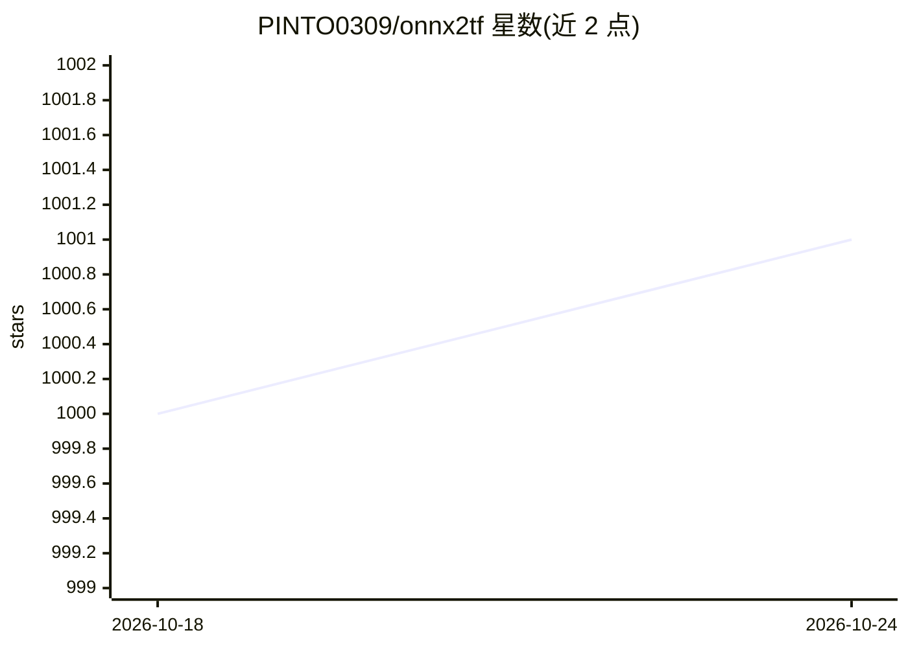

# PINTO0309/onnx2tf

⭐ 1,001 · Python · MIT · 推送 2026-09-14 · [GitHub](https://github.com/PINTO0309/onnx2tf) · 个人维护

**把 ONNX/LiteRT 模型转换为 TFLite、TensorFlow 与 PyTorch 格式的工具**

命令行模型转换工具，读取 ONNX 文件生成 LiteRT/TFLite、SavedModel、H5、Keras v3、TFv1 pb，以及 PyTorch 产物（nn.Module 包、TorchScript、state_dict、Exported Program、Dynamo ONNX），并支持从 .tflite 文件直接转换。默认 flatbuffer_direct 后端跳过逐节点 TensorFlow 转换，示例中 TFLite 写入阶段耗时约 0.239s（旧 tf_converter 路径约 24.947s）；tf_converter 后端支持 200 余种 ONNX 算子。部分选项组合（如 --disable_model_save 与 h5/keras_v3/pb 输出）会被显式拒绝。面向做模型部署与跨框架迁移的开发者。

## 筛选速览

| 维度 | 判定 | 备注 |
|---|---|---|
| AI 角色 | `ai-ecosystem` | LLM/agent 周边工具 |
| 许可风险 | `permissive` | MIT |
| 部署形态 | `library` | 以包/库形式分发 |
| 模型依赖 | — | README 未给出锁定关系 |
| 硬件要求 | — | 无带数字的原话,不猜 |
| 安装摩擦 | `low` | 无编译、无系统依赖或容器化 |
| 成熟度 | — | 结构信号不足 |

## 能力要点

- ONNX→LiteRT/TFLite/TensorFlow/PyTorch 多目标格式转换，含 LiteRT→PyTorch 反向路径
- 默认 flatbuffer_direct 快速路径，跳过逐节点 TF 转换
- 可从现有 .tflite 文件直接生成 SavedModel、.h5、PyTorch 包
- tf_converter 路径支持 200 余种 ONNX 算子并有覆盖状态表

## 适用场景

- 把训练导出的 ONNX 模型转成 TFLite 部署到移动/嵌入式设备
- 从 .tflite 模型反向生成 PyTorch 代码进行二次开发
- 跨框架迁移模型（TensorFlow↔PyTorch 生态）

## 场景标签

 · 领域:深度学习/模型转换工具

## 证据(README 行号)

> L2: A tool for converting ONNX files to LiteRT/TFLite/TensorFlow, PyTorch native code (nn.Module), TorchScript (.pt), st
> L227: `flatbuffer_direct` is now the default backend. It is faster and has a higher success rate than `tf_converter` for

## 星数曲线

2026-10-18 1,000 → 2026-10-24 1,001（+1）

---
*卡片 v1 · prompt 1.4 · 生成 2026-10-21 · 置信度 mid · 依据 README sha `edbb938e3049` · [字段定义](../../DATASET.md)*
